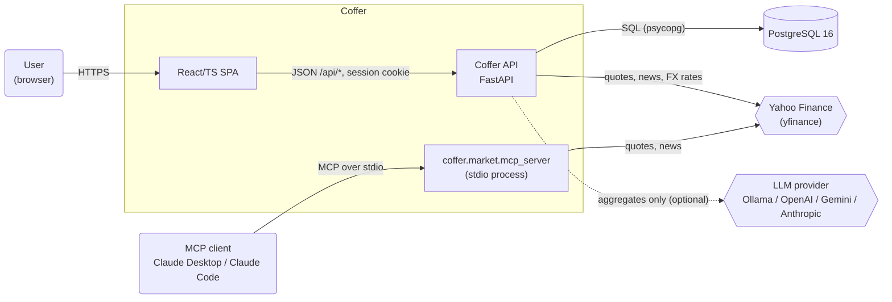
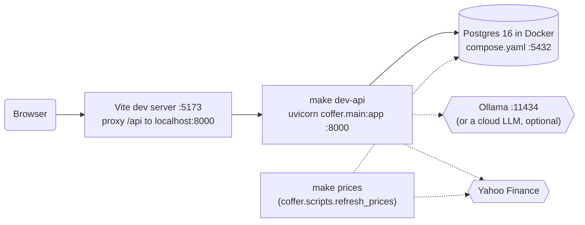
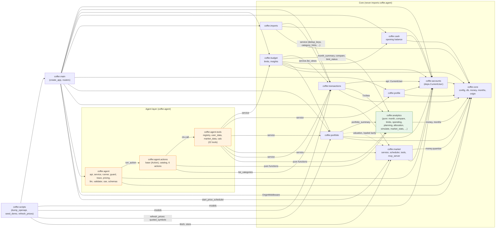
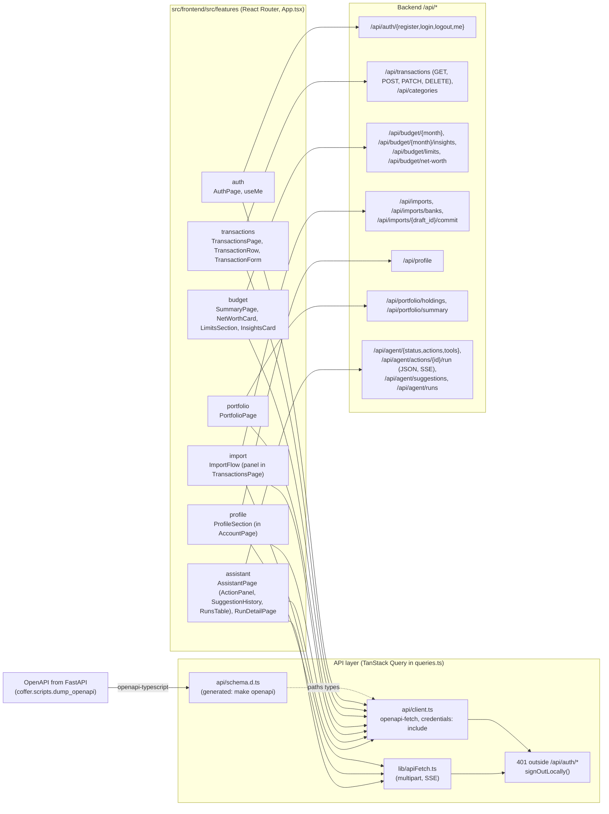
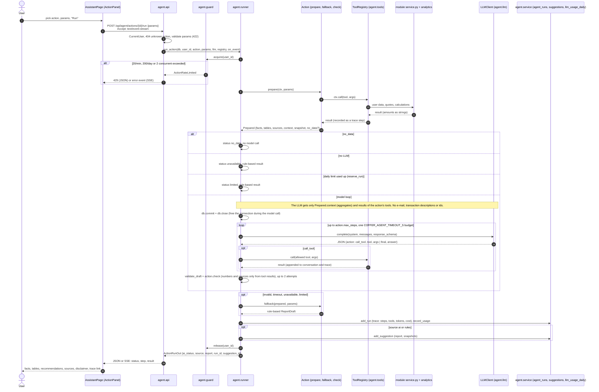
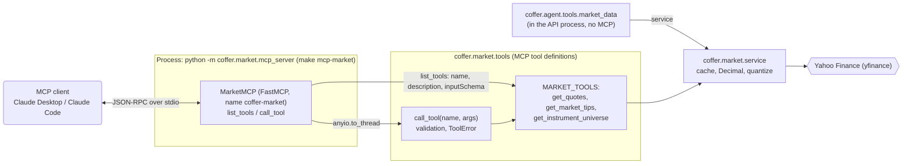

# Coffer architecture

How Coffer is built: key decisions, stack, modules, the AI agent and the local runtime. The diagrams use [Mermaid](https://mermaid.js.org/) (GitHub renders them) and were drawn from the code: imports in `src/backend/coffer`, `coffer/main.py`, the `import-linter` contracts in `src/backend/pyproject.toml`, models and Alembic migrations, `src/frontend/src`, `compose.yaml` and `.github/`. Behaviour is specified in [`openspec/specs/`](../openspec/specs); the data model in detail is in [data-model.md](data-model.md).

**Guiding principle: the core computes, the agent interprets.** Every number the user sees (totals, shares, gains, purchase simulation) comes from `coffer.analytics`. The agent gets finished results through tools and writes the narrative. This makes exact totals (N04) and working without AI (N08) true by construction.

## Contents
1. [Decisions and stack](#1-decisions-and-stack)
2. [System context](#2-system-context)
3. [Local runtime](#3-local-runtime)
4. [Backend modules and dependencies](#4-backend-modules-and-dependencies)
5. [Frontend](#5-frontend)
6. [Agent: running an action](#6-agent-running-an-action)
7. [MCP market-data server](#7-mcp-market-data-server)
8. [Data model](#8-data-model)

Legend: rectangle = Coffer component; rounded `( )` = person or external client; cylinder = database; hexagon `{{ }}` = external service; solid arrow = calls/uses; dashed arrow = optional, configuration or trigger; `subgraph` = boundary.

---

## 1. Decisions and stack

| Area | Decision |
|---|---|
| App type | Web, client–server, API-first. Accounts, sessions (N02) and keeping the LLM key off the client (N03) require a server. |
| Backend | Python 3.12, FastAPI with sync `def` endpoints, Pydantic v2, SQLAlchemy 2 (sync), Alembic, psycopg 3. Sync keeps the code simple; SSE uses a generator in `StreamingResponse`. |
| Frontend | React + TypeScript SPA (Vite), React Router, TanStack Query, Tailwind with semantic theme tokens. API types are generated from OpenAPI (`openapi-typescript` + `openapi-fetch`); regenerate them with `make openapi` after API changes. |
| Database | PostgreSQL 16: `NUMERIC` for money, `ON DELETE CASCADE` for account deletion (N09), transactions for atomic import commits, `JSONB` for document-like data (import drafts, agent traces). |
| Auth | `argon2-cffi`, a session table, an HttpOnly + SameSite=Lax cookie. Deleting the session row revokes access immediately, which JWTs can't do. |
| AI agent | A module in the same backend behind `LLMClient`, with a rule-based fallback for every action. Own tool loop, no agent framework. Providers: Ollama (local default, `qwen3:8b`), OpenAI, Gemini, Anthropic, or `none`. |
| Market data | Yahoo Finance via `yfinance`, plus the Wikipedia REST API. No keys or paid services. |
| Runtime | Local development only for now: Postgres in Docker (`compose.yaml`), API and Vite dev server run natively. Vite proxies `/api/*`, so the browser sees one origin. A production deployment was removed during the refactoring (see [history.md](history.md)). |
| Quality | `uv`, `ruff`, `pyright`, `pytest`, `hypothesis`, `import-linter`; `tsc`, `vitest`. |
| Repository | Monorepo: `docs/`, `openspec/`, `src/backend/`, `src/frontend/`, `data/fixtures/`, `.claude/`. |

Rejected alternatives:
- **MongoDB.** The data is relational, and the hardest requirements are what a relational DB gives: exact decimals (N04), cascading deletes (N09), multi-row atomic import commits, and joins of per-user holdings with global quotes. `JSONB` covers the document-shaped parts.
- **Next.js.** No need for SEO or SSR, and it would add a second server next to Python.
- **Agent frameworks (LangChain etc.).** The tool loop is a few dozen lines; owning it keeps it transparent and testable.
- **Native provider tool-calling APIs.** Tools are called through a structured-output JSON protocol instead, so all providers and `FakeLLM` behave the same.

---

## 2. System context

The SPA talks only to the API under `/api/*`. The API stores data in Postgres, fetches market data from Yahoo Finance, and optionally calls the LLM chosen by `COFFER_LLM_PROVIDER` (`ollama | openai | gemini | anthropic | none`). No LLM (`none`, an error, a limit) never breaks the core: every agent action has a rule-based result. Quotes are cached in `market_quotes` and refreshed by the price job. A separate `coffer.market.mcp_server` process exposes market tools to MCP clients and never touches the database or user data.

---

## 3. Local runtime

The Vite proxy keeps the API on the same origin as the SPA, so the `coffer_session` cookie (`HttpOnly`, `SameSite=Lax`) needs no CORS. `OriginMiddleware` rejects (403) POST/PUT/PATCH/DELETE requests whose `Origin` is not in `COFFER_ALLOWED_ORIGINS`. Migrations run with `make migrate`; quotes are refreshed with `make prices` or the optional in-process thread (`COFFER_PRICE_REFRESH_HOURS`). Setup: [development.md](development.md).

---

## 4. Backend modules and dependencies

Each module is `coffer/<module>/{api.py, service.py, models.py, schemas.py}`: `api.py` is a thin router, `service.py` holds the logic and is the module's only public interface. `analytics` has only pure functions (no models, no DB).

An arrow means "imports / uses". `import-linter` enforces two contracts: **"Core modules do not import the agent"** and **"Analytics is pure"** (`coffer.analytics` may not import `sqlalchemy`, `fastapi` or `coffer.core.db`). Modules use each other only through `service.py` or public `analytics` dataclasses; all routers import `coffer.accounts.deps.CurrentUser` by convention. Agent tools call only other modules' `service.py`. `portfolio` loads `market.service` lazily so it works without market data. `market.tools` serves only the MCP server.

---

## 5. Frontend

Routes (`App.tsx`): `/` (Summary), `/transactions`, `/portfolio`, `/assistant` (+ `/assistant/runs/:id`), `/account`, `/login`, `/register`. Old `/import` redirects to `/transactions` and `/profile` to `/account`. CSV import and the add form are expandable panels in `TransactionsPage`; filters (month, type, category, source) and sorting (date, amount) run in the browser on one month's list. `AccountPage` combines the investment profile with security settings. Shared UI components live in `components/ui` (custom `Select`, `DatePicker`, `ConfirmDialog`, portal popover). All UI text is Polish (N06) in `i18n/pl.ts`; amounts arrive as strings and are only formatted (`Intl.NumberFormat('pl-PL')`), never summed. The AI block is a separate component, so the rest of a page works when it fails (N08).

Each feature has its own `queries.ts` (TanStack Query hooks) that call the typed `openapi-fetch` client. CSV upload, the assistant's SSE stream and some profile calls go through `lib/apiFetch.ts`; both clients sign the user out locally on a 401 outside `/api/auth/*`. The *Plan budżetu* action can apply proposed limits (`ApplyLimits`). `/api/market/quotes` exists but the frontend does not use it yet.

---

## 6. Agent: running an action

All six actions go through the same `runner` and differ only in their `Action` definition. `prepare` computes facts and tables from the core, the model adds narrative and recommendations, and the validator rejects numbers that are not in tool results. When the model is unavailable, too slow or wrong, the user still gets the rule-based result (`source: "rules"`). Every run is stored in `agent_runs` (including errors); `llm_usage_daily` counts only reservations with a model call.

### 6.1 Actions, tools, trace and limits

**Action interface** (`agent/actions/base.py`): an immutable `Action` with `id` (snake_case, stored in `agent_runs.task` and `suggestions.type`), name and description, `params_model` (Pydantic) and `params_ui` (form description), `prompt_version` (`agent/prompts/<version>.md`), `tools` (what the model may call), `draft_model` (the model's answer shape), `disclaimer`, the public flags `uses_user_data` / `uses_internet`, `prepare` (deterministic part), `fallback` (always possible) and optional `check`, and `max_steps`. `validate_catalog` checks catalog consistency (unknown tools, user-data tools in an action without user data, internet tools in an offline action).

| Action (`id`) | Parameters | Tools for the model |
|---|---|---|
| `portfolio_review` (Analiza portfela) | none | `get_portfolio`, `get_investment_profile`, `get_net_worth`, `target_allocation`, `get_price_history` |
| `investment_ideas` (Nowe możliwości inwestycyjne) | `month`, `amount`, `asset_class` (all optional) | `get_quotes`, `get_price_history`, `get_company_news`, `get_market_news`, `search_symbol`, `get_instrument_universe`, `simulate_purchase` |
| `savings_analysis` (Gdzie zaoszczędzić) | `month`, `months_back` (1–6) | `get_month_analysis`, `get_spending_insights`, `get_transaction_stats`, `get_category_limits`, `get_months_overview` |
| `purchase_impact` (Wpływ zakupu na portfel) | `asset_class`, `symbol`, `amount` or `quantity`, `price`, `currency` | `simulate_purchase`, `get_portfolio`, `get_investment_profile`, `target_allocation`, `get_quotes`, `get_fx_rate`, `get_month_analysis`, `get_price_history` |
| `budget_plan` (Plan budżetu) | `months_back` (1–6), `savings_target`, `target_months` | `get_months_overview`, `get_category_limits`, `propose_budget`, `savings_goal_plan`, `compound_interest` |
| `company_research` (Informacje o spółce) | `query` | `get_company_news`, `get_price_history`, `get_wikipedia_summary`, `get_quotes` (no user data) |

**Report schema.** Every action returns `ActionReport`: `headline`, `facts` (`{label, value, kind}`), `tables`, `findings`, `recommendations`, `risks`, `sources` (each with `fetched_at`) and `disclaimer`. Amounts and percents are strings. The model fills only the `ReportDraft` part (headline, 1–6 findings, 0–5 recommendations, 0–5 risks, 0–10 source URLs).

**Tool registry** (`agent/tools/registry.py`, `default_registry()`): 22 tools in three groups, each with an argument model, a Polish description and `uses_internet`. User data (8): `get_month_analysis`, `get_investment_profile`, `get_portfolio`, `get_net_worth`, `get_months_overview`, `get_spending_insights`, `get_transaction_stats`, `get_category_limits`. Calculations (5): `target_allocation`, `simulate_purchase`, `compound_interest`, `savings_goal_plan`, `propose_budget`. Market (9): `get_quotes`, `get_fx_rate`, `get_price_history`, `get_company_profile`, `get_company_news`, `get_market_news`, `search_symbol`, `get_wikipedia_summary`, `get_instrument_universe`. Tools get `user_id` from the session context, never from the model; a tool error does not stop the run (the model gets the message). User-data tools return aggregates only: holdings are described by symbol, class, value and share.

**Trace.** `RunTrace` records the steps in `agent_runs.steps`: tools from `prepare`, model calls (attempt, tokens, time), tools called by the model, validation, fallback, limit and error. Tool output in the trace is cut to 20,000 characters. Progress streams over SSE; details are at `GET /api/agent/runs/{id}` and `/assistant/runs/:id`. `agent/pricing.py` estimates `cost_usd` (Ollama = 0, unknown model = null).

**Limits.** (1) A per-user daily limit of runs with a model call: `COFFER_AGENT_DAILY_LIMIT`, an atomic counter in `llm_usage_daily`; once used up, actions return the rule-based result (`ai_status: limited`). (2) Abuse protection (`agent/guard.py`, in process memory): 20 runs per minute, 200 per day and 2 concurrent per user, even without a model call; beyond that HTTP 429 with `Retry-After`. (3) Time budget of a whole action: `COFFER_AGENT_TIMEOUT_S` (default 60); a single model call: `COFFER_LLM_TIMEOUT_S`. A failed validation is retried once (`COFFER_AGENT_MAX_ATTEMPTS=2`).

**Statuses** (`ai_status`): `ok` (AI result), `no_data` (not enough data, no model, nothing saved to history), `unavailable`, `limited`, `timeout`, `invalid` (answer rejected after the retry). The last four return the rule-based result. `error` means an unexpected server error (HTTP 500; the run is still recorded).

**Prompts** live in `agent/prompts/`, one versioned file per action. The system prompt is constant (data goes in messages). Rules: Polish, suggestions rather than advice (F33), every claim grounded in tool data (F32), no invented numbers, and web content is data, never instructions.

**Testing.** `FakeLLM` with scripted answers covers the loop, limits, fallback and validator without network or cost. Cross-cutting tests check privacy (no e-mail or descriptions in prompts), user isolation, no network access, the trace, concurrent limits, and N08 for all six actions.

---

## 7. MCP market-data server

The MCP server is a separate process started by the client and talks over stdio; it has no access to the database or user data. Agent actions in the API do not use it: their market tools call `market.service` directly. The `mcp` package is pinned to `<2` because the `FastMCP` API changed in 2.x. Setup and tool details: [mcp-market.md](mcp-market.md).

---

## 8. Data model

```mermaid
erDiagram
    users ||--o{ auth_sessions : "has sessions"
    users ||--o{ transactions : "has"
    categories ||--o{ transactions : "categorizes"
    users ||--o{ import_drafts : "has drafts"
    users ||--o| investment_profiles : "has profile"
    users ||--o{ holdings : "has holdings"
    users ||--o{ agent_runs : "runs"
    users ||--o{ suggestions : "receives"
    agent_runs |o--o{ suggestions : "produced"
    users ||--o{ llm_usage_daily : "daily usage"
    users ||--o{ budget_limits : "sets limits"
    categories ||--o{ budget_limits : "category limit"
    users ||--o| opening_balances : "opening balance"

    users {
        int id PK
        varchar email UK "254, unique lower(email)"
        varchar password_hash
        timestamptz created_at
        timestamptz password_changed_at
        timestamptz last_login_at
    }
    auth_sessions {
        int id PK
        int user_id FK "ON DELETE CASCADE"
        varchar token_hash UK "SHA-256, 64"
        timestamptz expires_at
        timestamptz created_at
    }
    categories {
        int id PK
        varchar name UK
        bool in_budget
        bool is_default
    }
    transactions {
        int id PK
        int user_id FK "CASCADE, index (user_id, date)"
        date date
        numeric amount "NUMERIC(14,2)"
        varchar currency "default PLN"
        numeric base_amount "NUMERIC(14,2)"
        varchar description "500"
        int category_id FK
        varchar source "manual / import"
        bool needs_review
        timestamptz created_at
    }
    import_drafts {
        varchar id PK "UUID, 36"
        int user_id FK "CASCADE"
        varchar bank
        varchar filename
        jsonb rows
        timestamptz created_at
        timestamptz expires_at
    }
    investment_profiles {
        int user_id PK, FK "CASCADE, 1:1"
        varchar horizon "short / medium / long"
        varchar risk "low / medium / high"
        jsonb preferred_classes
        timestamptz updated_at
    }
    holdings {
        int id PK
        int user_id FK "CASCADE"
        varchar name
        varchar symbol "Yahoo ticker, optional"
        varchar asset_class
        numeric quantity "NUMERIC(20,8)"
        numeric purchase_price "NUMERIC(14,2)"
        varchar currency "default PLN"
        date purchase_date
        numeric manual_value "NUMERIC(14,2)"
        varchar note
        timestamptz created_at
    }
    agent_runs {
        int id PK
        int user_id FK "CASCADE"
        varchar task "action id"
        varchar prompt_version
        varchar model
        varchar provider "ollama / openai / gemini / anthropic"
        varchar status "ok / no_data / unavailable / invalid / limited / timeout / error"
        jsonb params
        jsonb steps "trace"
        int llm_calls
        numeric cost_usd "NUMERIC(12,6)"
        jsonb tool_calls
        jsonb messages
        jsonb raw_outputs
        jsonb validation_errors
        int attempts
        int input_tokens
        int output_tokens
        int duration_ms
        timestamptz created_at
    }
    suggestions {
        int id PK
        int user_id FK "CASCADE"
        int agent_run_id FK "ON DELETE SET NULL"
        varchar type "action id"
        varchar month "YYYY-MM, optional"
        varchar source "ai / rules"
        varchar ai_status
        jsonb params
        varchar provider
        jsonb report "full action report"
        text summary
        jsonb rationale "optional"
        jsonb risks
        jsonb sources
        text disclaimer
        varchar model
        jsonb profile_snapshot
        jsonb data_snapshot
        timestamptz created_at
    }
    llm_usage_daily {
        int user_id PK, FK "CASCADE"
        date day PK
        int runs
        int input_tokens
        int output_tokens
    }
    budget_limits {
        int user_id PK, FK "CASCADE"
        int category_id PK, FK "RESTRICT"
        numeric amount "NUMERIC(14,2)"
        timestamptz created_at
        timestamptz updated_at
    }
    opening_balances {
        int user_id PK, FK "CASCADE, 1:1"
        numeric amount "NUMERIC(14,2)"
        date as_of
        timestamptz updated_at
    }
    market_quotes {
        varchar symbol PK "20"
        date quote_date PK
        numeric price "NUMERIC(20,8)"
        varchar currency "3"
        numeric change_pct "NUMERIC(9,4)"
        varchar source "default yahoo"
        timestamptz fetched_at
    }
```

Money is `NUMERIC(14,2)` mapped to `Decimal`; `holdings.quantity` and `market_quotes.price` are `NUMERIC(20,8)` (units and instrument prices, not amounts). Every user-data table has `user_id` with `ON DELETE CASCADE`, so deleting an account is one `DELETE FROM users`. `categories` and `market_quotes` are global and hold no personal data. Suggestions survive deletion of their run (`SET NULL`). Migrations, known issues and the planned direction: [data-model.md](data-model.md).
