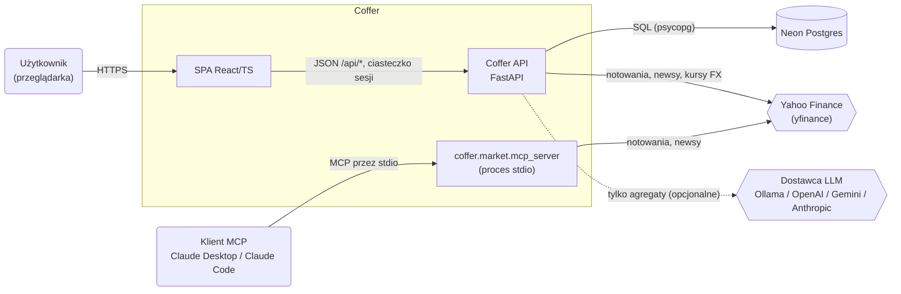
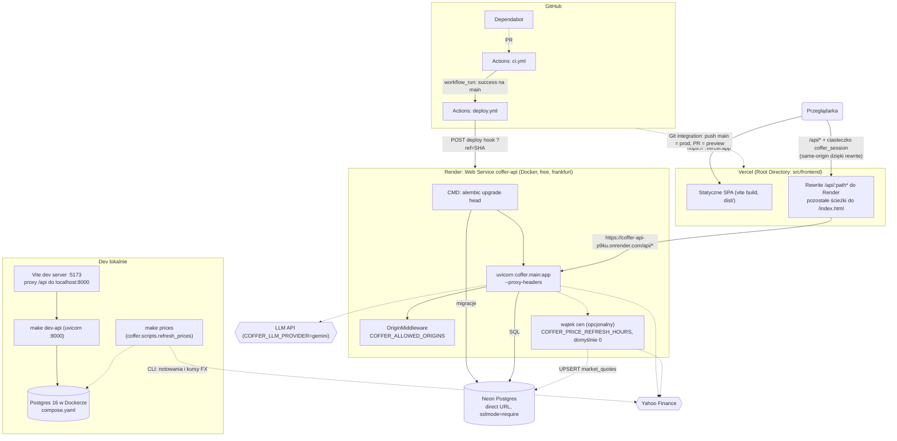
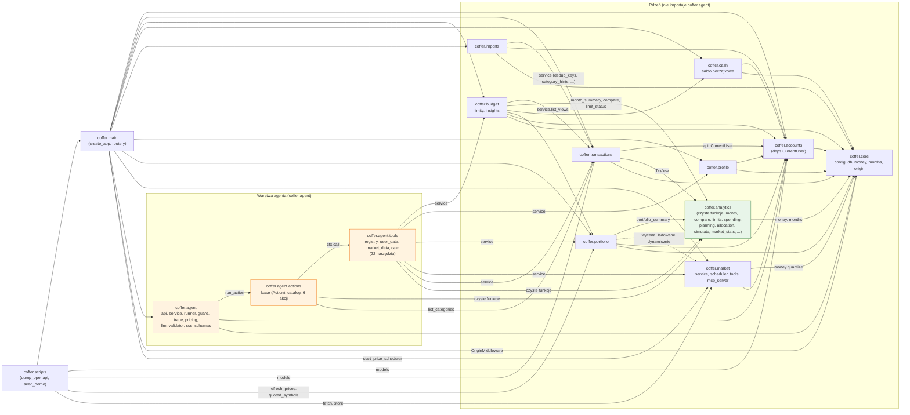
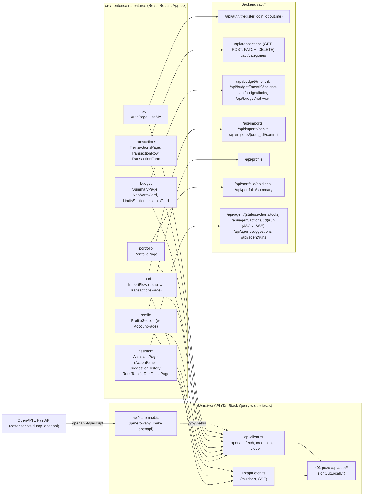
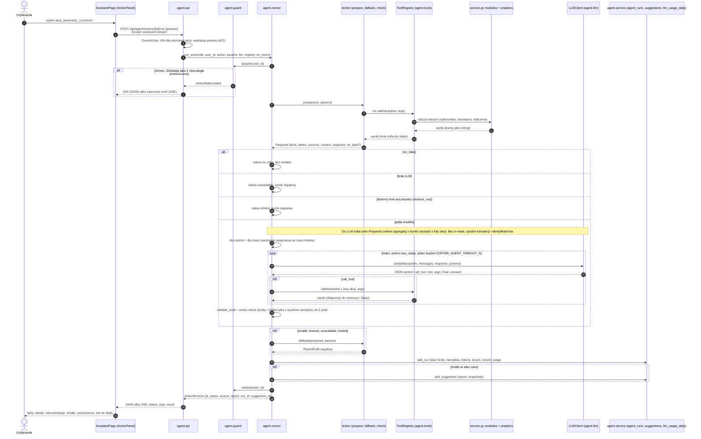
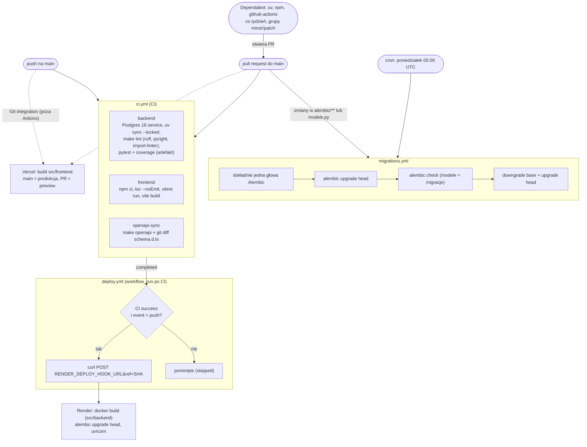

# Architektura systemu Coffer

Dokument opisuje architekturę Coffer w formie diagramów [Mermaid](https://mermaid.js.org/), które GitHub renderuje natywnie. Wszystkie diagramy powstały na podstawie kodu i konfiguracji repozytorium: importów w `src/backend/coffer`, `coffer/main.py`, kontraktów `import-linter` w `src/backend/pyproject.toml`, modeli SQLAlchemy i migracji Alembic, `src/frontend/src`, `render.yaml`, `src/backend/Dockerfile`, `src/frontend/vercel.json`, `compose.yaml`, `.github/` oraz `docs/deploy/*.md` i `docs/mcp-market.md`.

## Spis treści

1. [Kontekst systemu (C4, poziom 1)](#1-kontekst-systemu-c4-poziom-1)
2. [Wdrożenie](#2-wdrożenie)
3. [Moduły backendu i zależności](#3-moduły-backendu-i-zależności)
4. [Frontend](#4-frontend)
5. [Sekwencja: „Uruchom akcję” agenta](#5-sekwencja-uruchom-akcję-agenta)
6. [Serwer MCP z danymi rynkowymi](#6-serwer-mcp-z-danymi-rynkowymi)
7. [Model danych](#7-model-danych)
8. [Pipeline CI/CD](#8-pipeline-cicd)

## Legenda

| Element | Znaczenie |
|---|---|
| Prostokąt | komponent Coffer (moduł, usługa, strona) |
| Prostokąt zaokrąglony `( )` | osoba lub klient zewnętrzny |
| Cylinder `[( )]` | baza danych |
| Romb / sześciokąt `{{ }}` | system zewnętrzny lub usługa chmurowa |
| `-->` strzałka ciągła | wywołanie / „używa” / przepływ danych |
| `-.->` strzałka przerywana | zależność opcjonalna, konfiguracyjna lub wyzwalacz |
| `subgraph` | granica (system, platforma hostingowa, warstwa) |

---

## 1. Kontekst systemu (C4, poziom 1)

Użytkownik korzysta z Coffer przez przeglądarkę: SPA rozmawia wyłącznie z API pod `/api/*`. API przechowuje dane w Postgresie (produkcyjnie Neon), pobiera dane rynkowe z Yahoo Finance przez `yfinance` i opcjonalnie woła dostawcę LLM wybranego zmienną `COFFER_LLM_PROVIDER` (`ollama | openai | gemini | anthropic | none`). Brak LLM (`none`, błąd, limit) nie psuje rdzenia: każda akcja agenta ma wynik regułowy (fallback bez AI). Notowania są cache'owane w tabeli `market_quotes` i odświeżane jobem cen (opcjonalny wątek w API albo `make prices`). Osobny proces `coffer.market.mcp_server` udostępnia te same narzędzia rynkowe klientom MCP (Claude Desktop/Code) i nie dotyka bazy ani danych użytkownika.

---

## 2. Wdrożenie

Przeglądarka widzi tylko domenę Vercel: `vercel.json` przepisuje `/api/:path*` na `https://coffer-api-p9ku.onrender.com`, więc ciasteczko sesji `coffer_session` (`HttpOnly`, `SameSite=Lax`, `Secure` przez `COFFER_COOKIE_SECURE`) jest pierwszopartyjne i nie wymaga CORS. Dodatkowo `OriginMiddleware` odrzuca (403) żądania POST/PUT/PATCH/DELETE z nagłówkiem `Origin` spoza `COFFER_ALLOWED_ORIGINS`. Kontener Render (`src/backend/Dockerfile`) przy starcie wykonuje `alembic upgrade head`, potem uruchamia uvicorn; baza Neon jest podłączona direct URL-em (zalecenie z `docs/deploy/database.md`, pooled tylko z `-pooler` w hoście). Render ma `autoDeploy: false`: backend wdraża `deploy.yml` przez deploy hook, a frontend Vercel buduje sam z Git integration. Job cen odświeża tabelę `market_quotes` w tle co `COFFER_PRICE_REFRESH_HOURS` godzin (wątek w procesie API, blokada doradcza w bazie); na Render free zostaje wyłączony (`0`), bo instancja usypia. Ręcznie: `make prices`. Lokalnie Vite proxuje `/api` na `localhost:8000`, a Postgres działa w Dockerze z `compose.yaml`.

---

## 3. Moduły backendu i zależności

Strzałka oznacza „importuje / używa” (na podstawie `grep "^from coffer"` w `src/backend/coffer`). Reguły z `CLAUDE.md` i `import-linter` (`src/backend/pyproject.toml`): kontrakt **„Core modules do not import the agent”** zabrania modułom z podgrupy „Rdzeń” importu `coffer.agent`, a **„Analytics is pure”** zabrania `coffer.analytics` importu `sqlalchemy`, `fastapi` i `coffer.core.db`; oba kontrakty są dziś spełnione (`lint-imports`: 2 kept, 0 broken). Moduły powinny używać siebie nawzajem przez `service.py` (lub publiczne dataclassy `analytics`); routery wszystkich modułów importują `coffer.accounts.deps.CurrentUser`, co jest przyjętą konwencją. Od E5-09 `imports` nie importuje już modeli `transactions` (deduplikacja i podpowiedzi kategorii idą przez `transactions.service`), więc żadna krawędź nie wychodzi poza `service.py`. Narzędzia agenta (`agent.tools.*`) wołają wyłącznie `service.py` innych modułów (`budget`, `profile`, `portfolio`, `market`, `transactions`); `portfolio` ładuje `market.service` dynamicznie, żeby działać bez danych rynkowych i czyste funkcje `analytics`; sumy i wyceny liczy rdzeń, nie agent. `market.tools` służy już tylko serwerowi MCP (patrz diagram 6).

---

## 4. Frontend

Trasy (`App.tsx`): `/` (Podsumowanie), `/transactions`, `/portfolio`, `/assistant` (+ `/assistant/runs/:id`), `/account`, `/login`, `/register`. Stare `/import` przekierowuje do `/transactions`, `/profile` do `/account`. Import CSV i formularz dodawania to rozwijane panele w `TransactionsPage`; filtry (miesiąc, typ, kategoria, źródło) i sortowanie (data, kwota) działają po stronie klienta na liście jednego miesiąca. `AccountPage` łączy profil inwestycyjny (`ProfileSection`) z sekcją bezpieczeństwa. Wspólne komponenty UI w `components/ui` (m.in. własny `Select`, `DatePicker`, `ConfirmDialog`, popover w portalu).

Każdy feature ma własne `queries.ts` (hooki TanStack Query), które wołają API przez typowany klient `openapi-fetch` z `api/client.ts`; typy `paths` pochodzą z `api/schema.d.ts`, generowanego z OpenAPI backendu przez `make openapi` (job `openapi-sync` w CI pilnuje, by był aktualny). Upload CSV, strumień SSE asystenta i część wywołań profilu idą przez `lib/apiFetch.ts`; oba klienty stosują tę samą politykę: 401 poza `/api/auth/*` wylogowuje lokalnie. Karta *Wnioski* i limity kategorii korzystają z `/api/budget/*`; akcja *Plan budżetu* pozwala zastosować proponowane limity (`ApplyLimits`). Endpoint `/api/market/quotes` istnieje w backendzie, ale frontend go dziś nie używa.

---

## 5. Sekwencja: „Uruchom akcję” agenta

Wszystkie akcje (`portfolio_review`, `investment_ideas`, `savings_analysis`, `purchase_impact`, `budget_plan`, `company_research`) przechodzą przez ten sam `runner`; różnią się tylko definicją `Action` (parametry, `prepare`, lista narzędzi dostępnych dla modelu, `fallback`, dodatkowe `check`). Fakty i tabele liczy `prepare` z rdzenia, model dopisuje opis i rekomendacje, a walidator odrzuca liczby spoza wyników narzędzi. Gdy model jest niedostępny, za wolny albo odpowiada błędnie, użytkownik i tak dostaje wynik regułowy (`source: "rules"`); `no_data` kończy przebieg komunikatem bez zapisu sugestii. Tool calling działa przez ustrukturyzowane wyjście, więc działa z każdym dostawcą (`OllamaClient`, `OpenAIClient`, `GeminiClient`, `AnthropicClient`). Przebieg zawsze trafia do `agent_runs` (także przy `error`), a do `llm_usage_daily` tylko zużycie rezerwacji z modelem.

### 5.1 Katalog akcji, narzędzia, ślad i limity

**Interfejs akcji** (`agent/actions/base.py`): `Action` to niezmienny opis akcji: `id` (snake_case, trafia do `agent_runs.task` i `suggestions.type`), nazwa i opis, `params_model` (Pydantic, walidacja wejścia) i `params_ui` (opis formularza), `prompt_version` (plik `agent/prompts/<wersja>.md`), `tools` (które narzędzia wolno wołać modelowi), `draft_model` (kształt odpowiedzi modelu), `disclaimer`, flagi `uses_user_data` / `uses_internet` (publiczne, widoczne w `GET /api/agent/actions`), funkcje `prepare` (część deterministyczna), `fallback` (wynik bez AI, zawsze możliwy) i opcjonalne `check`, oraz `max_steps`. Spójność katalogu (nieznane narzędzia, narzędzia danych użytkownika w akcji bez danych użytkownika, narzędzia internetowe w akcji offline) sprawdza `validate_catalog`.

| Akcja (`id`) | Parametry | Narzędzia dla modelu |
|---|---|---|
| `portfolio_review` (Analiza portfela) | brak | `get_portfolio`, `get_investment_profile`, `get_net_worth`, `target_allocation`, `get_price_history` |
| `investment_ideas` (Nowe możliwości inwestycyjne) | `month`, `amount`, `asset_class` (wszystkie opcjonalne) | `get_quotes`, `get_price_history`, `get_company_news`, `get_market_news`, `search_symbol`, `get_instrument_universe`, `simulate_purchase` |
| `savings_analysis` (Gdzie zaoszczędzić) | `month`, `months_back` (1–6) | `get_month_analysis`, `get_spending_insights`, `get_transaction_stats`, `get_category_limits`, `get_months_overview` |
| `purchase_impact` (Wpływ zakupu na portfel) | `asset_class`, `symbol`, `amount` albo `quantity`, `price`, `currency` | `simulate_purchase`, `get_portfolio`, `get_investment_profile`, `target_allocation`, `get_quotes`, `get_fx_rate`, `get_month_analysis`, `get_price_history` |
| `budget_plan` (Plan budżetu) | `months_back` (1–6), `savings_target`, `target_months` | `get_months_overview`, `get_category_limits`, `propose_budget`, `savings_goal_plan`, `compound_interest` |
| `company_research` (Informacje o spółce) | `query` | `get_company_news`, `get_price_history`, `get_wikipedia_summary`, `get_quotes` (bez danych użytkownika) |

**Rejestr narzędzi** (`agent/tools/registry.py`, `default_registry()`): 22 narzędzia w trzech grupach, każde z modelem argumentów, opisem po polsku i polem `uses_internet`. Dane użytkownika (8): `get_month_analysis`, `get_investment_profile`, `get_portfolio`, `get_net_worth`, `get_months_overview`, `get_spending_insights`, `get_transaction_stats`, `get_category_limits`. Obliczenia (5): `target_allocation`, `simulate_purchase`, `compound_interest`, `savings_goal_plan`, `propose_budget`. Rynek (9): `get_quotes`, `get_fx_rate`, `get_price_history`, `get_company_profile`, `get_company_news`, `get_market_news`, `search_symbol`, `get_wikipedia_summary`, `get_instrument_universe`. `user_id` narzędzia dostają z kontekstu sesji, nie od modelu; błąd narzędzia nie przerywa przebiegu (model dostaje komunikat). Lista narzędzi: `GET /api/agent/tools`; katalog akcji: `GET /api/agent/actions`.

**Ślad.** `RunTrace` zapisuje kroki przebiegu (`agent_runs.steps`): narzędzia z `prepare`, wywołania modelu (próba, tokeny, czas), narzędzia wołane przez model, walidację, fallback, limit i błąd. Wynik narzędzia w śladzie jest przycinany do 20 000 znaków. Postęp (`status`, `step`) płynie przez SSE na bieżąco; szczegóły przebiegu: `GET /api/agent/runs/{id}` i strona `/assistant/runs/:id`. Koszt (`cost_usd`) szacuje `agent/pricing.py`.

**Limity.** (1) Dzienny limit przebiegów z modelem na użytkownika: `COFFER_AGENT_DAILY_LIMIT`, atomowy licznik `llm_usage_daily`; po wyczerpaniu akcja zwraca wynik regułowy (`ai_status: limited`). (2) Ochrona przed nadużyciem (`agent/guard.py`, pamięć procesu): 20 uruchomień akcji na minutę, 200 na dobę i 2 równolegle na użytkownika, także gdy model nie jest wołany; po przekroczeniu HTTP 429 z `Retry-After`. (3) Budżet czasu całej akcji: `COFFER_AGENT_TIMEOUT_S`; pojedyncze wywołanie modelu: `COFFER_LLM_TIMEOUT_S`.

**Statusy przebiegu** (`ai_status`): `ok` (wynik z AI), `no_data` (brak danych, bez modelu, bez sugestii w historii), `unavailable` (brak LLM lub niedostępny), `limited` (dzienny limit), `timeout`, `invalid` (odpowiedź odrzucona po poprawce); dla czterech ostatnich użytkownik dostaje wynik regułowy (`source: "rules"`). Status `error` oznacza nieoczekiwany błąd serwera (HTTP 500, przebieg zapisany).

---

## 6. Serwer MCP z danymi rynkowymi

Serwer MCP to osobny proces uruchamiany przez klienta (np. `claude mcp add coffer-market -- uv run --directory .../src/backend python -m coffer.market.mcp_server`) i komunikuje się przez stdio. Nazwy, opisy, schematy argumentów i walidacja narzędzi pochodzą z jednego miejsca, `coffer.market.tools`, więc klienci MCP widzą spójne narzędzia i limity. Akcje agenta w API nie korzystają z `market.tools` ani z serwera MCP: ich narzędzia rynkowe (`agent/tools/market_data.py`, w tym wiadomości, wyszukiwanie symboli i Wikipedia) wołają `market.service` bezpośrednio. Serwer nie ma dostępu do bazy ani do danych użytkownika: tylko publiczne dane rynkowe z `market.service`. Pakiet `mcp` jest przypięty do `<2` (Dependabot ignoruje major), bo w 2.x zmieniło się API `FastMCP`.

---

## 7. Model danych

```mermaid
erDiagram
    users ||--o{ auth_sessions : "ma sesje"
    users ||--o{ transactions : "ma"
    categories ||--o{ transactions : "kategoryzuje"
    users ||--o{ import_drafts : "ma szkice"
    users ||--o| investment_profiles : "ma profil"
    users ||--o{ holdings : "ma pozycje"
    users ||--o{ agent_runs : "uruchamia"
    users ||--o{ suggestions : "otrzymuje"
    agent_runs |o--o{ suggestions : "wygenerował"
    users ||--o{ llm_usage_daily : "dzienne zużycie"
    users ||--o{ budget_limits : "ustawia limity"
    categories ||--o{ budget_limits : "limit kategorii"
    users ||--o| opening_balances : "saldo początkowe"

    users {
        int id PK
        varchar email UK "254"
        varchar password_hash
        timestamptz created_at
        timestamptz password_changed_at
        timestamptz last_login_at
    }
    auth_sessions {
        int id PK
        int user_id FK "ON DELETE CASCADE"
        varchar token_hash UK "SHA-256, 64"
        timestamptz expires_at
        timestamptz created_at
    }
    categories {
        int id PK
        varchar name UK
        bool in_budget
        bool is_default
    }
    transactions {
        int id PK
        int user_id FK "CASCADE, indeks (user_id, date)"
        date date
        numeric amount "NUMERIC(14,2)"
        varchar currency "domyślnie PLN"
        numeric base_amount "NUMERIC(14,2)"
        varchar description "500"
        int category_id FK
        varchar source "manual / import"
        bool needs_review
        timestamptz created_at
    }
    import_drafts {
        varchar id PK "UUID, 36"
        int user_id FK "CASCADE"
        varchar bank
        varchar filename
        jsonb rows
        timestamptz created_at
        timestamptz expires_at
    }
    investment_profiles {
        int user_id PK, FK "CASCADE, 1:1"
        varchar horizon "short / medium / long"
        varchar risk "low / medium / high"
        jsonb preferred_classes
        timestamptz updated_at
    }
    holdings {
        int id PK
        int user_id FK "CASCADE"
        varchar name
        varchar symbol "ticker Yahoo, opcjonalny"
        varchar asset_class
        numeric quantity "NUMERIC(20,8)"
        numeric purchase_price "NUMERIC(14,2)"
        varchar currency "domyślnie PLN"
        date purchase_date
        numeric manual_value "NUMERIC(14,2)"
        varchar note
        timestamptz created_at
    }
    agent_runs {
        int id PK
        int user_id FK "CASCADE"
        varchar task "id akcji, np. budget_plan"
        varchar prompt_version "np. budget_plan_v1"
        varchar model
        varchar provider "ollama / openai / gemini / anthropic"
        varchar status "ok / no_data / unavailable / invalid / limited / timeout / error"
        jsonb params
        jsonb steps "ślad: kroki"
        int llm_calls
        numeric cost_usd "NUMERIC(12,6)"
        jsonb tool_calls
        jsonb messages
        jsonb raw_outputs
        jsonb validation_errors
        int attempts
        int input_tokens
        int output_tokens
        int duration_ms
        timestamptz created_at
    }
    suggestions {
        int id PK
        int user_id FK "CASCADE"
        int agent_run_id FK "ON DELETE SET NULL"
        varchar type "id akcji"
        varchar month "YYYY-MM, opcjonalny"
        varchar source "ai / rules"
        varchar ai_status
        jsonb params
        varchar provider
        jsonb report "pełny raport akcji"
        text summary
        jsonb rationale "opcjonalne"
        jsonb risks
        jsonb sources
        text disclaimer
        varchar model
        jsonb profile_snapshot
        jsonb data_snapshot
        timestamptz created_at
    }
    llm_usage_daily {
        int user_id PK, FK "CASCADE"
        date day PK
        int runs
        int input_tokens
        int output_tokens
    }
    budget_limits {
        int user_id PK, FK "CASCADE"
        int category_id PK, FK "RESTRICT"
        numeric amount "NUMERIC(14,2)"
        timestamptz created_at
        timestamptz updated_at
    }
    opening_balances {
        int user_id PK, FK "CASCADE, 1:1"
        numeric amount "NUMERIC(14,2)"
        date as_of
        timestamptz updated_at
    }
    market_quotes {
        varchar symbol PK "20"
        date quote_date PK
        numeric price "NUMERIC(20,8)"
        varchar currency "3"
        numeric change_pct "NUMERIC(9,4)"
        varchar source "domyślnie yahoo"
        timestamptz fetched_at
    }
```

Tabele pochodzą z modeli `coffer/*/models.py` i migracji `alembic/versions/0001_initial` (users, auth_sessions, categories, transactions), `0002_import_drafts`, `0003_profile_agent` (investment_profiles, agent_runs, suggestions), `0004_portfolio` (holdings), `0005_accounts` (kolumny `password_changed_at`, `last_login_at` w users), `0006_opening_balance` (opening_balances), `0007_agent_actions` (rozszerzenie agent_runs i suggestions, llm_usage_daily), `0008_budget_limits` i `0009_market_quotes`. `market_quotes` jest globalna (bez `user_id`): to cache publicznych notowań, a `budget_limits` ma klucz złożony `(user_id, category_id)`. Kwoty pieniężne to `NUMERIC(14,2)` mapowane na `Decimal`; `holdings.quantity` i `market_quotes.price` mają `NUMERIC(20,8)` (ilość jednostek i cena instrumentu, nie kwota). Każda tabela danych użytkownika ma `user_id` z `ON DELETE CASCADE`, a zapytania w `service.py` filtrują po nim; `categories` są globalne (słownik), a `suggestions` przeżywają usunięcie przebiegu agenta (`SET NULL`). Każde uruchomienie akcji (diagram 5) zapisuje wiersz `agent_runs`, a wynik z AI lub regułowy także wiersz `suggestions`.

---

## 8. Pipeline CI/CD

`ci.yml` uruchamia trzy równoległe joby (backend, frontend, openapi-sync) dla pushy i PR-ów do `main`; w CI `COFFER_LLM_PROVIDER=none`, a testy podmieniają klienta LLM. `deploy.yml` startuje po każdym zakończonym CI na `main`, ale wdraża tylko po sukcesie wywołanym pushem, i to dokładnie przetestowany commit (`ref=SHA`); bez sekretu `RENDER_DEPLOY_HOOK_URL` krok jest pomijany. `migrations.yml` to siatka bezpieczeństwa dla Alembic (PR-y dotykające migracji lub modeli plus cotygodniowy cron). Dependabot otwiera PR-y, które przechodzą przez to samo CI; ignoruje major `mcp` i `typescript`, które psują build.
