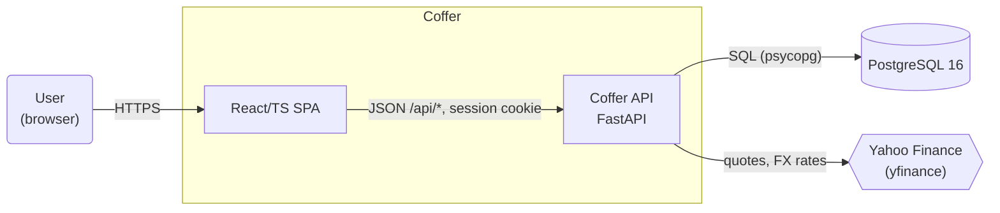
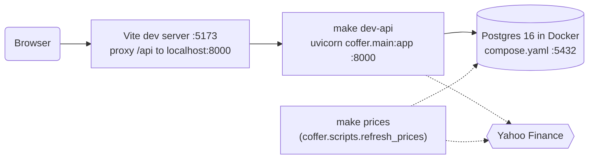
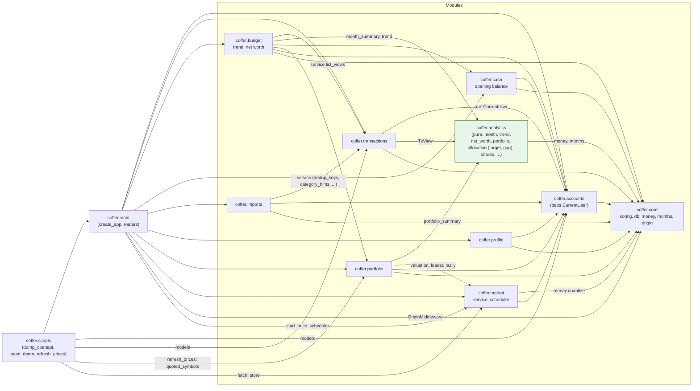
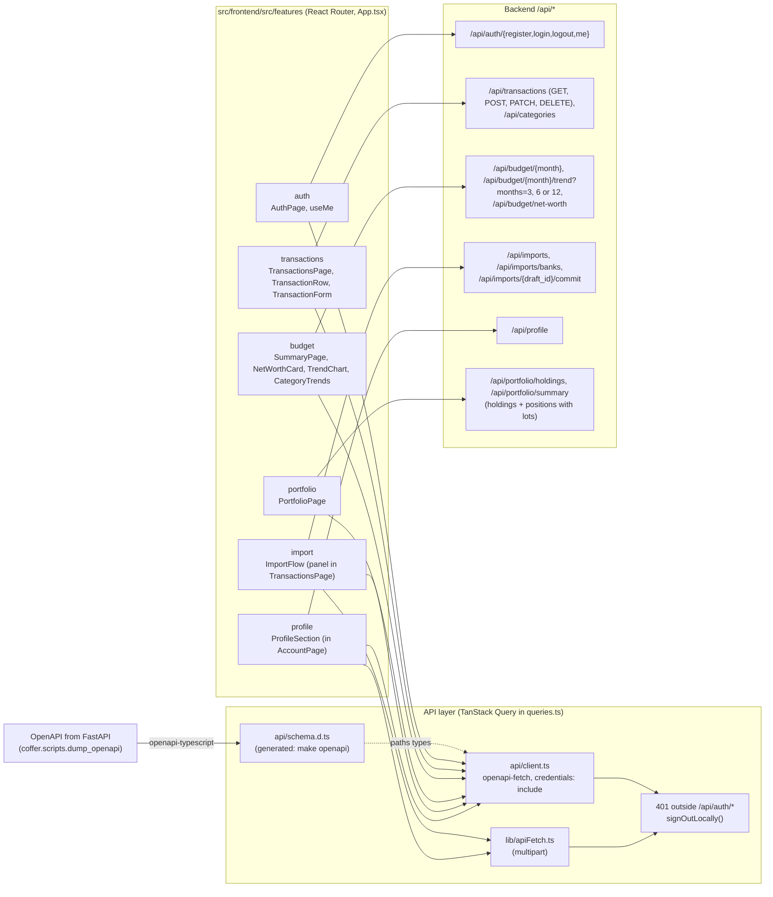
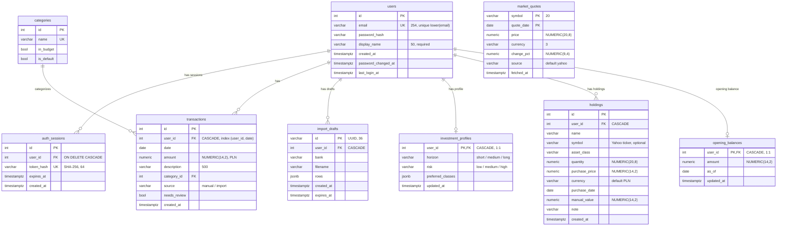

# Coffer architecture

How Coffer is built: key decisions, stack, modules and the local runtime. The diagrams use [Mermaid](https://mermaid.js.org/) (GitHub renders them) and were drawn from the code: imports in `src/backend/coffer`, `coffer/main.py`, the `import-linter` contracts in `src/backend/pyproject.toml`, models and Alembic migrations, `src/frontend/src`, and `compose.yaml`. Behaviour is specified in [`openspec/specs/`](../openspec/specs); the data model in detail is in [data-model.md](data-model.md).

**Guiding principle: the core computes.** Every number the user sees (totals, shares, gains) comes from `coffer.analytics`, which makes exact totals (N04) true by construction.

**The AI assistant was removed** during the refactoring and will be rebuilt for local LLMs afterwards (see the [roadmap](roadmap.md)). F31–F38 and N03 are currently unimplemented.

## Contents
1. [Decisions and stack](#1-decisions-and-stack)
2. [System context](#2-system-context)
3. [Local runtime](#3-local-runtime)
4. [Backend modules and dependencies](#4-backend-modules-and-dependencies)
5. [Frontend](#5-frontend)
6. [Data model](#6-data-model)

Legend: rectangle = Coffer component; rounded `( )` = person or external client; cylinder = database; hexagon `{{ }}` = external service; solid arrow = calls/uses; dashed arrow = optional, configuration or trigger; `subgraph` = boundary.

---

## 1. Decisions and stack

| Area | Decision |
|---|---|
| App type | Web, client–server, API-first. Accounts and sessions (N02) require a server. |
| Backend | Python 3.12, FastAPI with sync `def` endpoints, Pydantic v2, SQLAlchemy 2 (sync), Alembic, psycopg 3. Sync keeps the code simple. |
| Frontend | React + TypeScript SPA (Vite), React Router, TanStack Query, Tailwind with semantic theme tokens. API types are generated from OpenAPI (`openapi-typescript` + `openapi-fetch`); regenerate them with `make openapi` after API changes. |
| Database | PostgreSQL 16: `NUMERIC` for money, `ON DELETE CASCADE` for account deletion (N09), transactions for atomic import commits, `JSONB` for document-like data (import drafts). |
| Auth | `argon2-cffi`, a session table, an HttpOnly + SameSite=Lax cookie. Deleting the session row revokes access immediately, which JWTs can't do. |
| Market data | Yahoo Finance via `yfinance`. No keys or paid services. |
| Runtime | Local development only for now: Postgres in Docker (`compose.yaml`), API and Vite dev server run natively. Vite proxies `/api/*`, so the browser sees one origin. A production deployment was removed during the refactoring (see [history.md](history.md)). |
| Quality | `uv`, `ruff`, `pyright`, `pytest`, `hypothesis`, `import-linter`; `tsc`, `vitest`. |
| Repository | Monorepo: `docs/`, `openspec/`, `src/backend/`, `src/frontend/`, `data/fixtures/`, `.claude/`. |

Rejected alternatives:
- **MongoDB.** The data is relational, and the hardest requirements are what a relational DB gives: exact decimals (N04), cascading deletes (N09), multi-row atomic import commits, and joins of per-user holdings with global quotes. `JSONB` covers the document-shaped parts.
- **Next.js.** No need for SEO or SSR, and it would add a second server next to Python.

---

## 2. System context

The SPA talks only to the API under `/api/*`. The API stores data in Postgres, fetches market data from Yahoo Finance, and caches quotes in `market_quotes`, refreshed by the price job.

---

## 3. Local runtime

The Vite proxy keeps the API on the same origin as the SPA, so the `coffer_session` cookie (`HttpOnly`, `SameSite=Lax`) needs no CORS. `OriginMiddleware` rejects (403) POST/PUT/PATCH/DELETE requests whose `Origin` is not in `COFFER_ALLOWED_ORIGINS`. Migrations run with `make migrate`; quotes are refreshed with `make prices` or the optional in-process thread (`COFFER_PRICE_REFRESH_MINUTES`). Setup: [development.md](development.md).

---

## 4. Backend modules and dependencies

Each module is `coffer/<module>/{api.py, service.py, models.py, schemas.py}`: `api.py` is a thin router, `service.py` holds the logic and is the module's only public interface. `analytics` has only pure functions (no models, no DB).

An arrow means "imports / uses". `import-linter` enforces nine contracts: **"Analytics is pure"** (`coffer.analytics` may not import `sqlalchemy`, `fastapi` or `coffer.core.db`) and eight **"<module> does not read other modules' models"** contracts (a module may not import another module's `models`). Modules use each other only through `service.py` or public `analytics` dataclasses; all routers import `coffer.accounts.deps.CurrentUser` by convention. `portfolio` loads `market.service` lazily so it works without market data.

---

## 5. Frontend

Routes (`App.tsx`): `/` (Summary), `/transactions`, `/portfolio`, `/account`, `/login`, `/register`. Old `/import` redirects to `/transactions` and `/profile` to `/account`. CSV import and the add form are expandable panels in `TransactionsPage`; filters (month, type, category, source) and sorting (date, amount) run in the browser on one month's list. `AccountPage` combines the investment profile with security settings. Shared UI components live in `components/ui` (custom `Select`, `DatePicker`, `ConfirmDialog`, portal popover). All UI text is Polish (N06) in `i18n/pl.ts`; amounts arrive as strings and are only formatted, never summed.

**Look and shared pieces.** The theme is dark only; there is no theme switch. Colours, fonts and radii are semantic tokens in `index.css` (`@theme static`): `bg`, `surface`, `surface-2`, `border`, `text`, `muted`, `accent`, `positive`, `negative`, `warning`, `info` and the categorical `chart-1..7`. Feature code uses tokens only, so restyling means editing tokens or shared components. Geist and Geist Mono are self-hosted through `@fontsource-variable/*` (imported in `main.tsx`); no font CDN is used.

| Piece | Role |
|---|---|
| `lib/format.ts` | The only formatting module: `formatMoney`, `formatPct`, `signOf` (cached `Intl.NumberFormat('pl-PL')` per currency) |
| `components/Signed` | Amount or percentage coloured by sign (`positive` / `negative`), optional `+` and `invert` |
| `components/Money` | Plain amount, red only when negative |
| `components/ui/Stat` | Summary tile: label, value, optional delta |
| `components/ui/Bar`, `ui/BarList` | Progress/meter bar and a labelled list of bars (categories) |
| `features/portfolio/AllocationChart` | Hand-rolled SVG donut with legend (`role="img"` plus text legend); `compact` variant on Summary; colours from `chart-*`; optional `target` prop adds "cel" and gap rows (Summary and Portfolio) |

Each feature has its own `queries.ts` (TanStack Query hooks) that call the typed `openapi-fetch` client. CSV upload and some profile calls go through `lib/apiFetch.ts`; both clients sign the user out locally on a 401 outside `/api/auth/*`.

---

## 6. Data model

Money is `NUMERIC(14,2)` mapped to `Decimal`; `holdings.quantity` and `market_quotes.price` are `NUMERIC(20,8)` (units and instrument prices, not amounts). Every user-data table has `user_id` with `ON DELETE CASCADE`, so deleting an account is one `DELETE FROM users`. `categories` and `market_quotes` are global and hold no personal data. Migrations, known issues and the planned direction: [data-model.md](data-model.md).
