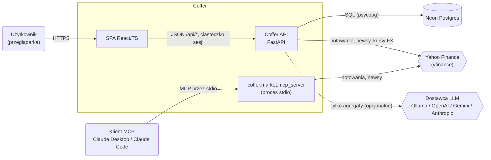
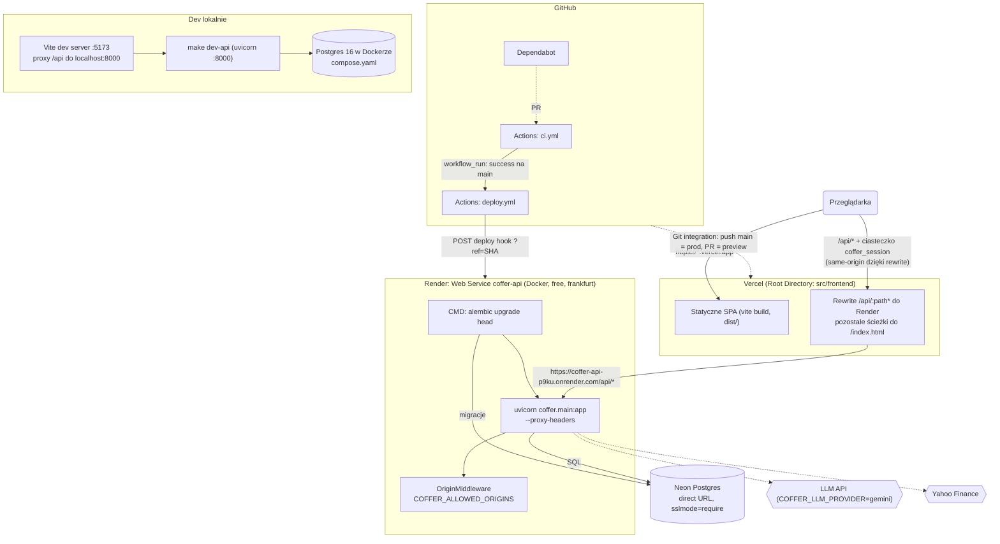
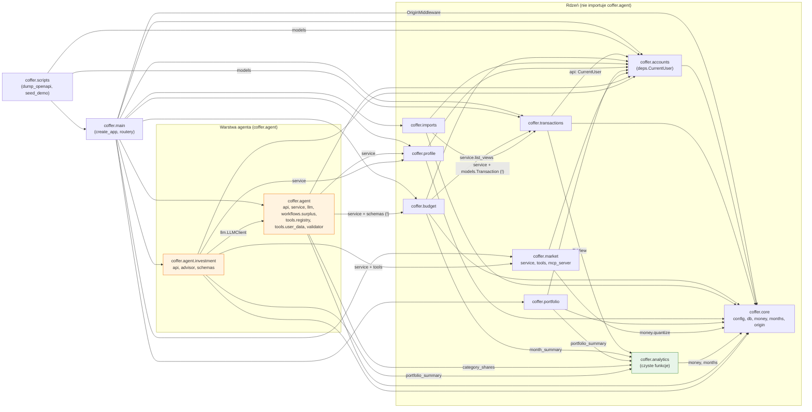
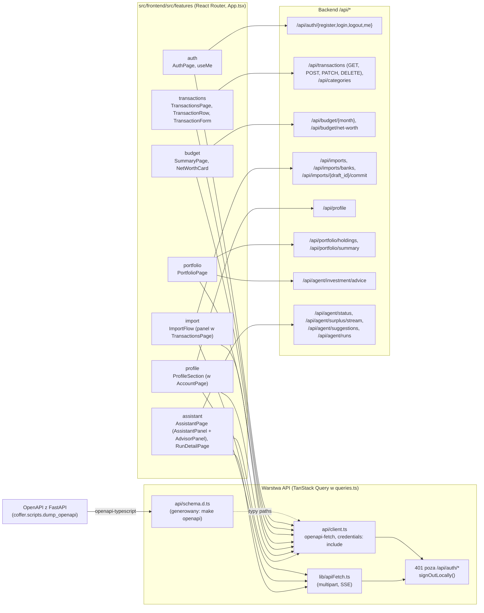
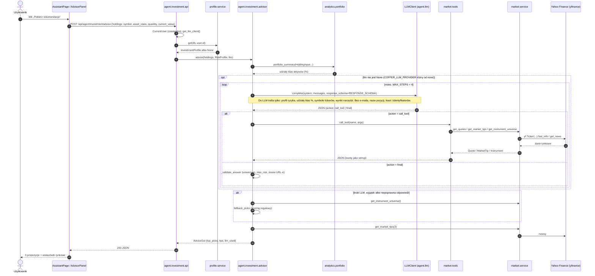
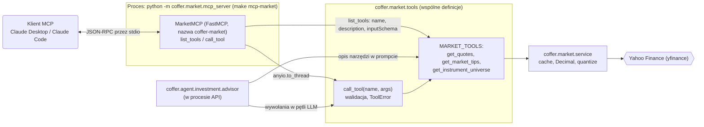
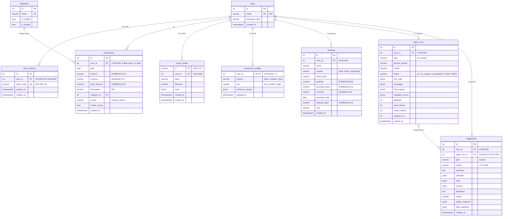
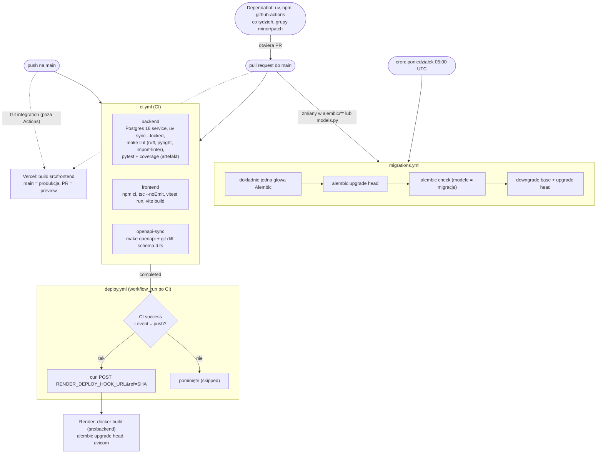

# Architektura systemu Coffer

Dokument opisuje architekturę Coffer w formie diagramów [Mermaid](https://mermaid.js.org/), które GitHub renderuje natywnie. Wszystkie diagramy powstały na podstawie kodu i konfiguracji repozytorium: importów w `src/backend/coffer`, `coffer/main.py`, kontraktów `import-linter` w `src/backend/pyproject.toml`, modeli SQLAlchemy i migracji Alembic, `src/frontend/src`, `render.yaml`, `src/backend/Dockerfile`, `src/frontend/vercel.json`, `compose.yaml`, `.github/` oraz `docs/deploy/*.md` i `docs/mcp-market.md`.

## Spis treści

1. [Kontekst systemu (C4, poziom 1)](#1-kontekst-systemu-c4-poziom-1)
2. [Wdrożenie](#2-wdrożenie)
3. [Moduły backendu i zależności](#3-moduły-backendu-i-zależności)
4. [Frontend](#4-frontend)
5. [Sekwencja: „Pobierz rekomendacje” w Portfelu](#5-sekwencja-pobierz-rekomendacje-w-portfelu)
6. [Serwer MCP z danymi rynkowymi](#6-serwer-mcp-z-danymi-rynkowymi)
7. [Model danych](#7-model-danych)
8. [Pipeline CI/CD](#8-pipeline-cicd)

## Legenda

| Element | Znaczenie |
|---|---|
| Prostokąt | komponent Coffer (moduł, usługa, strona) |
| Prostokąt zaokrąglony `( )` | osoba lub klient zewnętrzny |
| Cylinder `[( )]` | baza danych |
| Romb / sześciokąt `{{ }}` | system zewnętrzny lub usługa chmurowa |
| `-->` strzałka ciągła | wywołanie / „używa” / przepływ danych |
| `-.->` strzałka przerywana | zależność opcjonalna, konfiguracyjna lub wyzwalacz |
| `subgraph` | granica (system, platforma hostingowa, warstwa) |

---

## 1. Kontekst systemu (C4, poziom 1)

Użytkownik korzysta z Coffer przez przeglądarkę: SPA rozmawia wyłącznie z API pod `/api/*`. API przechowuje dane w Postgresie (produkcyjnie Neon), pobiera dane rynkowe z Yahoo Finance przez `yfinance` i opcjonalnie woła dostawcę LLM wybranego zmienną `COFFER_LLM_PROVIDER` (`ollama | openai | gemini | anthropic | none`). Brak LLM (`none` albo błąd) nie psuje rdzenia: doradca i asystent mają ścieżki zastępcze. Osobny proces `coffer.market.mcp_server` udostępnia te same narzędzia rynkowe klientom MCP (Claude Desktop/Code) i nie dotyka bazy ani danych użytkownika.

---

## 2. Wdrożenie

Przeglądarka widzi tylko domenę Vercel: `vercel.json` przepisuje `/api/:path*` na `https://coffer-api-p9ku.onrender.com`, więc ciasteczko sesji `coffer_session` (`HttpOnly`, `SameSite=Lax`, `Secure` przez `COFFER_COOKIE_SECURE`) jest pierwszopartyjne i nie wymaga CORS. Dodatkowo `OriginMiddleware` odrzuca (403) żądania POST/PUT/PATCH/DELETE z nagłówkiem `Origin` spoza `COFFER_ALLOWED_ORIGINS`. Kontener Render (`src/backend/Dockerfile`) przy starcie wykonuje `alembic upgrade head`, potem uruchamia uvicorn; baza Neon jest podłączona direct URL-em (zalecenie z `docs/deploy/database.md`, pooled tylko z `-pooler` w hoście). Render ma `autoDeploy: false`: backend wdraża `deploy.yml` przez deploy hook, a frontend Vercel buduje sam z Git integration. Lokalnie Vite proxuje `/api` na `localhost:8000`, a Postgres działa w Dockerze z `compose.yaml`.

---

## 3. Moduły backendu i zależności

Strzałka oznacza „importuje / używa” (na podstawie `grep "^from coffer"` w `src/backend/coffer`). Reguły z `CLAUDE.md` i `import-linter` (`src/backend/pyproject.toml`): kontrakt **„Core modules do not import the agent”** zabrania modułom z podgrupy „Rdzeń” importu `coffer.agent`, a **„Analytics is pure”** zabrania `coffer.analytics` importu `sqlalchemy`, `fastapi` i `coffer.core.db`; oba kontrakty są dziś spełnione (`lint-imports`: 2 kept, 0 broken). Moduły powinny używać siebie nawzajem przez `service.py` (lub publiczne dataclassy `analytics`); routery wszystkich modułów importują `coffer.accounts.deps.CurrentUser`, co jest przyjętą konwencją. Krawędzie oznaczone `(!)` wychodzą poza `service.py`: `imports.service` używa `transactions.models.Transaction`, a `agent.schemas` i `agent.workflows.surplus` używają `budget.schemas.MonthSummaryOut`; `agent.investment.advisor` korzysta z `market.tools`, czyli wspólnych definicji narzędzi (zamierzone, patrz diagram 6).

---

## 4. Frontend

Trasy (`App.tsx`): `/` (Podsumowanie), `/transactions`, `/portfolio`, `/assistant` (+ `/assistant/runs/:id`), `/account`, `/login`, `/register`. Stare `/import` przekierowuje do `/transactions`, `/profile` do `/account`. Import CSV i formularz dodawania to rozwijane panele w `TransactionsPage`; filtry (miesiąc, typ, kategoria, źródło) i sortowanie (data, kwota) działają po stronie klienta na liście jednego miesiąca. `AccountPage` łączy profil inwestycyjny (`ProfileSection`) z sekcją bezpieczeństwa. Wspólne komponenty UI w `components/ui` (m.in. własny `Select`, `DatePicker`, `ConfirmDialog`, popover w portalu).

Każdy feature ma własne `queries.ts` (hooki TanStack Query), które wołają API przez typowany klient `openapi-fetch` z `api/client.ts`; typy `paths` pochodzą z `api/schema.d.ts`, generowanego z OpenAPI backendu przez `make openapi` (job `openapi-sync` w CI pilnuje, by był aktualny). Upload CSV, strumień SSE asystenta i część wywołań profilu idą przez `lib/apiFetch.ts`; oba klienty stosują tę samą politykę: 401 poza `/api/auth/*` wylogowuje lokalnie. Endpoint `/api/market/quotes` istnieje w backendzie, ale frontend go dziś nie używa.

---

## 5. Sekwencja: „Pobierz rekomendacje” w Portfelu

Frontend wysyła tylko zagregowane pozycje portfela (symbol, klasa, ilość, bieżąca wartość); profil ryzyka API czyta z `profile.service` (brak profilu oznacza domyślny `RiskProfile()`). Tool calling działa przez ustrukturyzowane wyjście: każdy krok `LLMClient.complete(response_schema=...)` zwraca albo `call_tool`, albo `final`, więc działa z każdym dostawcą (`OllamaClient`, `OpenAIClient`, `GeminiClient`, `AnthropicClient`). Odpowiedź modelu jest walidowana względem uniwersum instrumentów i maksymalnego ryzyka profilu; przy braku LLM, wyjątku lub złej odpowiedzi działa deterministyczny `fallback_picks`, a flaga `llm_used` mówi, która ścieżka zadziałała.

---

## 6. Serwer MCP z danymi rynkowymi

Serwer MCP to osobny proces uruchamiany przez klienta (np. `claude mcp add coffer-market -- uv run --directory .../src/backend python -m coffer.market.mcp_server`) i komunikuje się przez stdio. Nazwy, opisy, schematy argumentów i walidacja narzędzi pochodzą z jednego miejsca, `coffer.market.tools`, więc klient MCP i doradca inwestycyjny widzą te same narzędzia i limity. Serwer nie ma dostępu do bazy ani do danych użytkownika: tylko publiczne dane rynkowe z `market.service`. Pakiet `mcp` jest przypięty do `<2` (Dependabot ignoruje major), bo w 2.x zmieniło się API `FastMCP`.

---

## 7. Model danych

Tabele pochodzą z modeli `coffer/*/models.py` i migracji `alembic/versions/0001_initial` (users, auth_sessions, categories, transactions), `0002_import_drafts`, `0003_profile_agent` (investment_profiles, agent_runs, suggestions) i `0004_portfolio` (holdings). Kwoty pieniężne to `NUMERIC(14,2)` mapowane na `Decimal`; jedynie `holdings.quantity` ma `NUMERIC(20,8)`, bo to ilość jednostek, nie kwota. Każda tabela danych użytkownika ma `user_id` z `ON DELETE CASCADE`, a zapytania w `service.py` filtrują po nim; `categories` są globalne (słownik), a `suggestions` przeżywają usunięcie przebiegu agenta (`SET NULL`). Doradca inwestycyjny (diagram 5) nie zapisuje niczego do bazy.

---

## 8. Pipeline CI/CD

`ci.yml` uruchamia trzy równoległe joby (backend, frontend, openapi-sync) dla pushy i PR-ów do `main`; w CI `COFFER_LLM_PROVIDER=none`, a testy podmieniają klienta LLM. `deploy.yml` startuje po każdym zakończonym CI na `main`, ale wdraża tylko po sukcesie wywołanym pushem, i to dokładnie przetestowany commit (`ref=SHA`); bez sekretu `RENDER_DEPLOY_HOOK_URL` krok jest pomijany. `migrations.yml` to siatka bezpieczeństwa dla Alembic (PR-y dotykające migracji lub modeli plus cotygodniowy cron). Dependabot otwiera PR-y, które przechodzą przez to samo CI; ignoruje major `mcp` i `typescript`, które psują build.
