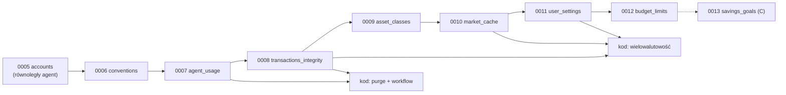

# Model danych Coffer

Dokument projektowy bazy danych: stan obecny (migracje `0001`–`0005`), model docelowy, zasady modelowania dla zespołu i plan migracji od `0006`. Uzupełnia diagram 7 w [`architecture.md`](architecture.md), który pokazuje stan obecny. Gdy kod i ten dokument się rozjadą, źródłem prawdy są migracje w `src/backend/alembic/versions/`; ten dokument opisuje **kierunek**.

Skróty: **UC**: przypadek użycia, **F/N/Z**: wymagania z [`requirements.md`](requirements.md), **CASCADE**: `ON DELETE CASCADE`.

---

## 1. Stan obecny

Baza: PostgreSQL 16 (lokalnie Docker, produkcyjnie Neon Free). Schemat tworzą wyłącznie migracje Alembic; testy też budują go przez `alembic upgrade head` (`tests/conftest.py`), więc CHECK-i z migracji działają w testach.

### 1.1 Tabele

**`users`** (moduł `accounts`; migracja `0001`; stan po `0005`: patrz 1.3)

| Kolumna | Typ | Ograniczenia |
|---|---|---|
| id | `integer` (serial) | PK |
| email | `varchar(254)` | NOT NULL, UNIQUE `users_email_key` (nazwa nadana przez Postgresa, wielkość liter rozróżniana; zmienione w `0005`) |
| password_hash | `varchar` | NOT NULL |
| created_at | `timestamptz` | NOT NULL, default `now()` |

**`auth_sessions`** (`accounts`, `0001`): `id` PK, `user_id` FK→users CASCADE (indeks `ix_auth_sessions_user_id`), `token_hash varchar(64)` UNIQUE, `expires_at timestamptz`, `created_at timestamptz`. Wygasłe sesje nie są nigdzie usuwane poza wylogowaniem (indeks `expires_at` dochodzi w `0005`, samo sprzątanie nadal brak).

**`categories`** (`transactions`, `0001`, globalna, seed 11 wierszy w migracji): `id` PK, `name varchar(50)` UNIQUE, `in_budget bool`, `is_default bool`. Brak stabilnego kodu kategorii (logika i LLM posługują się polską nazwą), nic nie gwarantuje dokładnie jednej kategorii domyślnej.

**`transactions`** (`transactions`, `0001`)

| Kolumna | Typ | Ograniczenia |
|---|---|---|
| id | `integer` | PK |
| user_id | `integer` | FK→users CASCADE; indeksy `ix_transactions_user_id` i `ix_transactions_user_id_date (user_id, date)` |
| date | `date` | NOT NULL |
| amount | `numeric(14,2)` | NOT NULL, brak CHECK (dopuszcza 0) |
| currency | `varchar(3)` | NOT NULL, default `PLN`, brak CHECK |
| base_amount | `numeric(14,2)` | NOT NULL; dziś zawsze = `amount` (`transactions/service.py` wpisuje na sztywno PLN) |
| description | `varchar(500)` | NOT NULL |
| category_id | `integer` | FK→categories, `ON DELETE NO ACTION`, brak indeksu |
| source | `varchar(10)` | NOT NULL, brak CHECK (`manual`/`import` tylko w kodzie) |
| needs_review | `bool` | NOT NULL, default false |
| created_at | `timestamptz` | NOT NULL |

**`import_drafts`** (`imports`, `0002`): `id varchar(36)` PK (UUID jako tekst), `user_id` FK CASCADE + indeks, `bank varchar(50)`, `filename varchar(255)`, `rows jsonb`, `created_at`, `expires_at timestamptz`. Wygasłe szkice usuwa tylko `imports/service.py` przy kolejnym dostępie **tego samego** użytkownika.

**`investment_profiles`** (`profile`, `0003`): `user_id` PK+FK CASCADE (1:1), `horizon varchar(10)`, `risk varchar(10)`, `preferred_classes jsonb`, `updated_at`. Brak CHECK-ów; dozwolone wartości tylko w `profile/models.py`.

**`agent_runs`** (`agent`, `0003`): `id` PK, `user_id` FK CASCADE, `task varchar(30)`, `prompt_version`, `model`, `status varchar(20)`, `tool_calls/messages/raw_outputs/validation_errors jsonb NOT NULL default '[]'`, `error text`, `attempts int`, `input_tokens/output_tokens/duration_ms int`, `created_at`. Osobne indeksy `user_id` i `created_at`.

**`suggestions`** (`agent`, `0003`): `id` PK, `user_id` FK CASCADE, `agent_run_id` FK→agent_runs `SET NULL`, `type varchar(30)`, `month varchar(7)`, `summary/disclaimer text`, `rationale/risks/sources/profile_snapshot/data_snapshot jsonb`, `model`, `duration_ms`, `created_at`. Osobne indeksy `user_id` i `created_at`.

**`holdings`** (`portfolio`, `0004`): `id` PK, `user_id` FK CASCADE + indeks, `name varchar(100)`, `symbol varchar(20)` NULL, `asset_class varchar(20)` + `CHECK ck_holdings_asset_class`, `quantity numeric(20,8)` + `CHECK quantity > 0`, `purchase_price numeric(14,2)`, `currency varchar(3)` default PLN, `purchase_date date` NULL, `manual_value numeric(14,2)` NULL, `note varchar(500)`, `created_at`.

### 1.2 Ocena problemów

Kolejność od najpoważniejszych.

1. **Koszt LLM bez kontroli w doradcy inwestycyjnym.** `agent/investment/api.py` woła model bez zapisu do `agent_runs` i bez limitu dziennego; limit z `agent/workflows/surplus.py` (`count_runs_today`) dotyczy tylko nadwyżki. Do tego limit liczony jest zapytaniem `COUNT` przed wywołaniem modelu, więc dwa równoległe żądania mogą oba przejść (wyścig). Brak audytu narusza też ideę N09/„ślad przebiegu”.
2. **Rozjechane słowniki klas aktywów.** `profile` używa `cash, deposit, stocks, etf, bonds, crypto, real_estate`, `portfolio` używa `stock, etf, bond, real_estate, commodity, crypto, cash`. Ten sam pojęciowo kod („akcje”) ma dwie wartości, a `deposit` (lokaty, N5) nie da się zapisać w portfelu. Agent dopasowujący portfel do profilu (F36, F37) porównuje niekompatybilne kody.
3. **Wielowalutowość tylko na papierze.** Kolumny `currency` i `base_amount` istnieją, ale serwis wpisuje PLN, a parser odrzuca inne waluty. Nie ma miejsca na kurs użyty do przeliczenia, więc N04 („zgodne co do grosza”) nie da się odtworzyć po fakcie. Nie ma też waluty bazowej użytkownika (Z4).
4. **Cena jednostkowa `numeric(14,2)`** w `holdings.purchase_price` ucina ceny tańsze niż 0,01 (kryptowaluty, jednostki funduszy), a ilość ma 8 miejsc. Wartość pozycji `quantity × price` traci precyzję przed `quantize`.
5. **Brak CHECK-ów na danych domenowych:** waluty (dowolne 3 znaki), `transactions.amount` (0), `source`, `agent_runs.status/task`, `investment_profiles.*`, `suggestions.month` (dowolny tekst), `holdings.manual_value` (ujemna). Walidacja żyje tylko w Pydantic, więc skrypty (`seed_demo.py`) i przyszłe migracje danych mogą ją obejść.
6. **Indeksy nie pod realne zapytania.** `count_runs_today` filtruje `user_id + created_at` (dwa osobne indeksy zamiast złożonego); `list_suggestions` / `list_runs` sortują po `created_at DESC, id DESC` w obrębie użytkownika (to samo). `ix_transactions_user_id` jest nadmiarowy wobec `(user_id, date)`. Brak indeksu na `transactions.category_id` (FK). Brak indeksów pod sprzątanie (`expires_at`).
7. **Brak retencji.** Wygasłe `auth_sessions` i porzucone `import_drafts` (użytkownik nie wraca) zostają na zawsze; `agent_runs.messages/raw_outputs` (kilka–kilkanaście KB na przebieg) rosną bez limitu. Przy Neon Free (0,5 GB) to główne ryzyko rozmiaru (patrz 2.9).
8. **Nazwy ograniczeń nadawane przez Postgresa** (`users_email_key`, `transactions_category_id_fkey`): `Base` nie ma `naming_convention`, więc nazwy zależą od silnika, a migracje usuwające je muszą zgadywać.
9. **Drobne:** `import_drafts.id` jako `varchar(36)` zamiast `uuid`; brak `updated_at` w `transactions` i `holdings` (UC-03, F21 edytują); `categories` bez stabilnego kodu i bez gwarancji jednej kategorii domyślnej; `CHECK`-i `holdings` są tylko w migracji, nie w `models.py` (`alembic check` ich nie porównuje, więc dryf jest niewidoczny).
10. **Granica modułów:** `imports/service.py` importuje `coffer.transactions.models.Transaction` i sam czyta tabelę (`_existing`). Zgodnie z CLAUDE.md powinien użyć funkcji z `transactions/service.py`.

Co jest dobrze i zostaje: wszystkie FK do `users` mają CASCADE (UC-08 / N09 wykona się jednym `DELETE FROM users`), wszystkie znaczniki czasu to `timestamptz`, kwoty to `numeric`, JSONB tylko tam, gdzie dane są dokumentem (szkic importu, ślad agenta, migawka sugestii), `suggestions.agent_run_id` ma `SET NULL`, więc retencja śladów nie kasuje sugestii.

### 1.3 Stan po `0005` (moduł `accounts`, równoległy agent)

Przeczytane z `src/backend/alembic/versions/0005_accounts.py` i `coffer/accounts/models.py` (stan roboczy, przed commitem właściciela):

- `users.email`: ograniczenie `users_email_key` usunięte, w jego miejsce **unikalny indeks wyrażeniowy `ux_users_email_lower ON users (lower(email))`**. Migracja normalizuje istniejące adresy (`lower(btrim(email))`) i przerywa się, jeśli znajdzie duplikaty różniące się wielkością liter (nie zgaduje, które konto zostawić). `accounts/service.py` zapisuje e-mail już znormalizowany (`normalize_email`).
- `users`: nowe kolumny audytowe `password_changed_at timestamptz NULL` i `last_login_at timestamptz NULL`.
- `auth_sessions`: nowy indeks `ix_auth_sessions_expires_at` (pod sprzątanie wygasłych sesji; tego wymaga retencja z 2.9).
- **Brak tabeli `login_attempts`**: ograniczanie prób logowania (`accounts/ratelimit.py`, `SlidingWindowLimiter`) trzyma stan w pamięci procesu. Konsekwencja dla modelu danych: brak danych do retencji, ale limit zeruje się przy restarcie i nie jest współdzielony między workerami. Akceptowalne dla jednej instancji Render; przy skalowaniu w poziomie trzeba będzie tabeli (właściciel `accounts`, klucz `(key, window_start)`, retencja 24 h).
- UC-08 jest zaimplementowany jako `accounts.service.delete_account`: weryfikacja hasła i `DELETE FROM users`; resztę usuwa CASCADE. To potwierdza decyzję 2.9: każda nowa tabela z `user_id` **musi** mieć CASCADE, inaczej usunięcie konta zakończy się błędem FK albo zostawi dane.
- Downgrade `0005` przywraca `users_email_key`, ale nie przywraca pierwotnej wielkości liter adresów (normalizacja nieodwracalna; opisane w migracji).

Plan poniżej zaczyna się od `0006` z `down_revision = "0005"`. Struktury `users` i `auth_sessions` nie zmienia; `0006` zmienia w nich wyłącznie nazwy ograniczeń (po uzgodnieniu z właścicielem).

---

## 2. Model docelowy

### 2.1 Diagram

Walidowany przez `@mermaid-js/mermaid-cli@11.4.2`. Encje bez relacji (`market_quotes`, `fx_rates`) to globalne tabele bez danych osobowych; `transactions.fx_rate` i `holdings.symbol` odwołują się do nich logicznie, bez FK (cache może zostać wyczyszczony).

```mermaid
erDiagram
    users ||--o{ auth_sessions : "ma sesje"
    users ||--o| user_settings : "ma ustawienia"
    users ||--o| investment_profiles : "ma profil"
    users ||--o{ transactions : "ma"
    categories ||--o{ transactions : "kategoryzuje"
    users ||--o{ budget_limits : "ustawia"
    categories ||--o{ budget_limits : "ogranicza"
    users ||--o{ savings_goals : "ma cele"
    users ||--o{ import_drafts : "ma szkice"
    users ||--o{ holdings : "ma pozycje"
    users ||--o{ agent_runs : "uruchamia"
    users ||--o{ suggestions : "otrzymuje"
    agent_runs |o--o{ suggestions : "wygenerowal"
    users ||--o{ llm_usage_daily : "zuzywa"

    users {
        int id PK
        varchar email "unikalny indeks lower(email), 0005"
        varchar password_hash
        timestamptz password_changed_at "0005"
        timestamptz last_login_at "0005"
        timestamptz created_at
    }
    auth_sessions {
        int id PK
        int user_id FK "CASCADE"
        varchar token_hash UK "SHA-256"
        timestamptz expires_at "indeks pod purge"
        timestamptz created_at
    }
    user_settings {
        int user_id PK, FK "CASCADE, 1:1"
        char base_currency "ISO 4217, domyslnie PLN"
        timestamptz updated_at
    }
    investment_profiles {
        int user_id PK, FK "CASCADE, 1:1"
        varchar horizon "CHECK short/medium/long"
        varchar risk "CHECK low/medium/high"
        jsonb preferred_classes "CHECK tablica kodow klas"
        timestamptz updated_at
    }
    categories {
        int id PK
        varchar code UK "stabilny kod, np. food"
        varchar name UK "nazwa PL do UI"
        bool in_budget
        bool is_default "max 1 wiersz true"
        smallint sort_order
    }
    transactions {
        int id PK
        int user_id FK "CASCADE"
        date date "indeks (user_id, date, id)"
        numeric amount "14,2; CHECK <> 0"
        char currency "ISO 4217"
        numeric fx_rate "18,8; CHECK > 0"
        numeric base_amount "14,2; w walucie bazowej"
        varchar description "500"
        int category_id FK "RESTRICT"
        varchar source "CHECK manual/import"
        bool needs_review
        timestamptz created_at
        timestamptz updated_at
    }
    budget_limits {
        int user_id PK, FK "CASCADE"
        int category_id PK, FK "RESTRICT"
        numeric amount "14,2; CHECK > 0"
        timestamptz created_at
        timestamptz updated_at
    }
    savings_goals {
        int id PK
        int user_id FK "CASCADE"
        varchar name "100"
        numeric target_amount "14,2; CHECK > 0"
        date target_date
        timestamptz created_at
    }
    import_drafts {
        uuid id PK
        int user_id FK "CASCADE"
        varchar bank
        varchar filename
        jsonb rows "CHECK tablica"
        timestamptz created_at
        timestamptz expires_at "indeks pod purge"
    }
    holdings {
        int id PK
        int user_id FK "CASCADE"
        varchar name "100"
        varchar symbol "ticker Yahoo, opcjonalny"
        varchar asset_class "CHECK wspolny slownik"
        numeric quantity "20,8; CHECK > 0"
        numeric purchase_price "20,8 cena jednostkowa; CHECK >= 0"
        char currency "ISO 4217"
        date purchase_date
        numeric manual_value "14,2; CHECK >= 0"
        varchar note "500"
        timestamptz created_at
        timestamptz updated_at
    }
    market_quotes {
        varchar symbol PK
        date quote_date PK
        numeric price "20,8"
        char currency "ISO 4217"
        varchar source "yahoo"
        timestamptz fetched_at
    }
    fx_rates {
        char base_ccy PK
        char quote_ccy PK
        date rate_date PK
        numeric rate "18,8; CHECK > 0"
        varchar source "nbp / yahoo"
        timestamptz fetched_at
    }
    agent_runs {
        int id PK
        int user_id FK "CASCADE, indeks (user_id, created_at)"
        varchar task "CHECK surplus/advisor/company/chat"
        varchar prompt_version
        varchar model
        varchar status "CHECK ok/no_surplus/unavailable/invalid/limited"
        jsonb tool_calls "NULL po 30 dniach"
        jsonb messages "NULL po 30 dniach"
        jsonb raw_outputs "NULL po 30 dniach"
        jsonb validation_errors
        text error
        int attempts
        int input_tokens
        int output_tokens
        int duration_ms
        timestamptz created_at
    }
    suggestions {
        int id PK
        int user_id FK "CASCADE, indeks (user_id, created_at)"
        int agent_run_id FK "SET NULL"
        varchar type "CHECK surplus"
        varchar month "CHECK YYYY-MM"
        text summary
        jsonb rationale
        jsonb risks
        jsonb sources
        text disclaimer
        varchar model
        jsonb profile_snapshot
        jsonb data_snapshot
        int duration_ms
        timestamptz created_at
    }
    llm_usage_daily {
        int user_id PK, FK "CASCADE"
        date day PK "UTC"
        int runs "CHECK >= 0"
        int input_tokens
        int output_tokens
    }
```

### 2.2 Własność tabel (granice modułów)

| Moduł (`coffer/<moduł>/models.py`) | Tabele | Kto czyta z innych modułów (tylko przez `service.py`) |
|---|---|---|
| `accounts` | `users`, `auth_sessions` | wszyscy przez `deps.CurrentUser` |
| `profile` | `investment_profiles`, **`user_settings`** (nowa) | `agent` (profil), `transactions`/`portfolio`/`budget` (waluta bazowa) |
| `transactions` | `categories`, `transactions` | `budget`, `imports`, `agent.tools` |
| `budget` | **`budget_limits`**, **`savings_goals`** (nowe; moduł dostaje `models.py`) | `agent.tools` |
| `imports` | `import_drafts` | nikt |
| `portfolio` | `holdings` | `agent` |
| `market` | **`market_quotes`**, **`fx_rates`** (nowe) | `portfolio`, `transactions`, `agent` |
| `agent` | `agent_runs`, `suggestions`, **`llm_usage_daily`** (nowa) | nikt (rdzeń nie importuje `agent`) |
| `analytics` | **żadnych**: czyste funkcje na dataclassach, bez `sqlalchemy` (pilnuje import-linter) | |

Zasada: tabelę zmienia (migracja + `models.py`) tylko jej moduł-właściciel. FK między modułami są dozwolone (np. `budget_limits.category_id → categories`), ale kod modułu nie importuje cudzych modeli.

### 2.3 Decyzja (a): portfel to pozycje, nie dziennik operacji

**Decyzja:** `holdings` zostaje źródłem prawdy (jedna pozycja = klasa, ticker, ilość, średnia cena zakupu, data). **Nie** wprowadzamy `portfolio_transactions` (kupno/sprzedaż/dywidenda) z `holdings` jako widokiem.

Uzasadnienie: UC-04 i F20–F24 są sformułowane na pozycjach („dodaj aktywo: ilość, cena zakupu”, „zysk względem ceny zakupu”), Z2 zakłada, że użytkownik zna skład portfela i go wpisuje, a W3 wyklucza obrót. Dziennik operacji wymusza metodę rozliczenia (FIFO / średnia), zrealizowany zysk, obsługę dywidend i podziałów akcji w `analytics`, czyli kilka kart pracy bez wymagania, które by tego potrzebowało. Zmiany w modelu ograniczamy do jakości danych: `purchase_price` rozszerzone do `numeric(20,8)` (cena jednostkowa, nie kwota), wspólny słownik klas, waluta ISO, `updated_at`.

Ścieżka ewolucji (poza tym planem): jeśli pojawi się wymaganie historii, dochodzi tabela `portfolio_operations` należąca do `portfolio`, a `holdings` zostaje jako tabela pozycji otwarcia; migracja danych zamienia każdą pozycję na operację „otwarcie”.

### 2.4 Decyzja (b): notowania i kursy FX zapisywane w bazie

**Decyzja:** dwie globalne tabele modułu `market`: `fx_rates (base_ccy, quote_ccy, rate_date)` i `market_quotes (symbol, quote_date)`. Pamięciowy cache z `market/service.py` (TTL 5 min) zostaje jako pierwsza warstwa; baza jest drugą warstwą i historią.

Uzasadnienie:
- Z4 mówi o **kursie dziennym**: przeliczenie transakcji z 12 marca musi użyć kursu z 12 marca (NBP, tabela A), także przy imporcie wyciągu sprzed miesięcy. Tego nie da się zrobić bez historii kursów.
- F25 („aktualizacja cen co najmniej raz dziennie”) i N07 („data pobrania”) wymagają trwałego `fetched_at`.
- Render (darmowy plan) usypia i restartuje proces, a przy kilku workerach każdy ma własny cache. Bez bazy każde wybudzenie to seria zapytań do Yahoo (limity źródła, `plan.md`, ryzyko 4).
- Rozmiar jest pomijalny (2.9).

Szczegóły: jeden wiersz na dzień (ostatnia znana cena dnia; kolejne pobranie tego samego dnia robi `UPSERT`), `rate numeric(18,8)`, `price numeric(20,8)`, `source` (`nbp`/`yahoo`). Brak FK z `transactions`: transakcja zapisuje **użyty kurs** w `transactions.fx_rate`, więc wyczyszczenie cache niczego nie psuje. Serwer MCP (`market/mcp_server.py`) dalej działa bez bazy: zapis do bazy jest w osobnych funkcjach serwisu przyjmujących `db`, a ścieżka bez `db` korzysta tylko z pamięci. Docstring „no database” w `market/service.py` trzeba wtedy zaktualizować.

### 2.5 Decyzja (c): kategorie globalne ze stabilnym kodem

**Decyzja:** kategorie zostają **globalne** (seed w migracji, tylko do odczytu dla użytkownika). Dochodzi kolumna `code varchar(30) UNIQUE` (np. `food`, `transport`, `own_transfer`) i `sort_order`; częściowy indeks unikalny `uq_categories_single_default ON categories ((true)) WHERE is_default` gwarantuje jedną kategorię domyślną. FK z `transactions` jawnie `ON DELETE RESTRICT`.

Uzasadnienie: żadne wymaganie nie każe użytkownikowi tworzyć kategorii (F07, F08 i F10 operują na stałej liście), automatyczna kategoryzacja (N05: 80% na zbiorze testowym) i prompty agenta są strojone pod stałą listę, a kategorie per użytkownik mnożą dane i komplikują porównania F12/F15. `code` oddziela logikę (kategoryzator, `analytics`, agent) od polskiej nazwy w UI, którą można wtedy poprawiać bez łamania kodu.

### 2.6 Decyzja (d): budżety jako stały limit miesięczny na kategorię

**Decyzja:** `budget_limits (user_id, category_id)` jako PK złożony, `amount numeric(14,2) CHECK > 0`. Limit obowiązuje w każdym miesiącu, aż użytkownik go zmieni lub usunie (F13: „miesięczny limit dla kategorii”). Nie przechowujemy limitów per miesiąc ani „wykonania”: przekroczenie (F14) liczy `analytics.month_summary` z transakcji i limitów przekazanych jako dataclass. Limit tylko dla kategorii z `in_budget = true`: to reguła w `budget/service.py` (CHECK nie może sięgać do innej tabeli).

Cele oszczędnościowe (F16, F17, priorytet C) to osobna tabela `savings_goals`; migracja na końcu planu i tylko gdy zespół weźmie F16.

### 2.7 Decyzja (e) i (g): waluta oryginalna + kwota bazowa zamrożona przy zapisie; waluta bazowa w `user_settings`

**Decyzja:**
- `transactions` przechowuje trójkę `amount` + `currency` (jak w wyciągu), `fx_rate` (użyty kurs, `numeric(18,8)`, `1` dla waluty bazowej) i `base_amount = quantize(amount × fx_rate)` w walucie bazowej. Wszystkie sumy (`analytics`) liczą wyłącznie `base_amount`. Kurs pochodzi z `fx_rates` dla `date` transakcji (NBP; brak notowania w weekend/święto → ostatni wcześniejszy dzień roboczy). Brak kursu → transakcja nie jest zapisywana, import oznacza wiersz błędem („Brak kursu … z dnia …”). `fx_rate` daje odtwarzalność N04.
- Waluta bazowa to `user_settings.base_currency char(3) default 'PLN'` (Z4) w nowej tabeli 1:1 należącej do `profile`. Brak wiersza = PLN, więc nie trzeba backfillu dla istniejących kont.
- **Zmiana waluty bazowej jest zablokowana, gdy użytkownik ma transakcje lub pozycje** (komunikat w `profile/service.py`). Przeliczanie wstecz całej historii to migracja danych w żądaniu HTTP; projekt studencki tego nie potrzebuje.

Dlaczego osobna tabela, a nie kolumna w `users`: `users` czyta każde żądanie (`CurrentUser`), należy do `accounts` i ma zostać wąską tabelą tożsamości. Ustawienia mają innego właściciela i cykl zmian.

Waluty: `char(3)` + `CHECK (x ~ '^[A-Z]{3}$')` na każdej kolumnie walutowej. Lista **obsługiwanych** walut (PLN, EUR, USD, GBP, CHF na start) jest stałą w `coffer/core/money.py`, walidowaną w Pydantic. Bez tabeli słownikowej walut: lista jest mała, stała i nie ma atrybutów.

### 2.8 Decyzja (f): każde wywołanie LLM zostawia ślad i zużywa wspólny limit

**Decyzja:**
1. Każdy przepływ wołający model (nadwyżka, doradca inwestycyjny, informacje o spółce, przyszły czat) zapisuje wiersz `agent_runs` z `task` z zamkniętej listy (`CHECK task IN ('surplus','advisor','company','chat')`).
2. Nowa tabela `llm_usage_daily (user_id, day)` z licznikami `runs`, `input_tokens`, `output_tokens`. Przed wywołaniem modelu `agent/service.py: reserve_run(db, user_id, now)` wykonuje **atomowe** `INSERT … ON CONFLICT (user_id, day) DO UPDATE SET runs = runs + 1 … RETURNING runs` i odmawia (`status = 'limited'`), gdy przekroczono `agent_daily_limit`; po odpowiedzi dopisuje tokeny. To usuwa wyścig z `COUNT(*)` i jest niezależne od retencji `agent_runs`.
3. Limity w `Settings`: dzienny limit przebiegów **wspólny dla wszystkich zadań** oraz dzienny limit tokenów na użytkownika. Domyślna wartość 50/dzień jest rozsądna dla lokalnego modelu; dla płatnego dostawcy produkcja ustawia niższą (np. 20) przez zmienną środowiskową. Globalny bezpiecznik kosztów (suma po wszystkich użytkownikach w danym dniu) to jedno zapytanie po indeksie `ix_llm_usage_daily_day`.
4. Indeks `(user_id, created_at)` na `agent_runs` i `suggestions` pod listy „ostatnie N” i liczenie dnia.

Prywatność (N03): `messages` zawiera tylko to, co poszło do modelu, czyli agregaty bez e-maila i opisów transakcji. Mimo to treść śladu jest kasowana po 30 dniach (2.9).

### 2.9 Decyzja (h): retencja i rozmiar pod Neon Free (0,5 GB)

**Twarde usuwanie, bez soft delete.** Żadna tabela nie dostaje `deleted_at`: UC-08/N09 wymaga trwałego usunięcia, sumy w `analytics` nie muszą wtedy pamiętać o filtrze, a „kosz” nie jest wymaganiem. Usunięcie konta to `DELETE FROM users WHERE id = :id`; CASCADE na każdym FK do `users` czyści resztę. Każda nowa tabela z `user_id` **musi** mieć CASCADE (sprawdza to test, patrz 3.7). Tabele globalne (`categories`, `fx_rates`, `market_quotes`) nie zawierają danych osobowych. Uwaga RODO: kopie w historii Neon (przywracanie punktu w czasie) znikają po upływie okna przywracania planu; należy to opisać w polityce prywatności, nie da się tego obejść w schemacie.

**Retencja:**

| Tabela | Reguła | Mechanizm |
|---|---|---|
| `auth_sessions` | usuń `expires_at < now()` | purge dzienny |
| `import_drafts` | usuń `expires_at < now()` | purge dzienny + dotychczasowe sprzątanie per użytkownik |
| `agent_runs` | po 30 dniach `messages`, `raw_outputs`, `tool_calls` = NULL; po 180 dniach usuń wiersz | purge dzienny |
| `llm_usage_daily` | usuń `day < today − 90` | purge dzienny |
| `market_quotes`, `fx_rates` | trzymaj 3 lata | purge dzienny |
| `transactions`, `holdings`, `suggestions`, `budget_limits`, `savings_goals`, profile, ustawienia | do usunięcia przez użytkownika lub konta | CASCADE |

Mechanizm purge: każdy moduł-właściciel wystawia w `service.py` funkcję `purge_expired(db, now) -> int`; skrypt `coffer/scripts/purge.py` woła je po kolei, a uruchamia go codziennie workflow GitHub Actions (`schedule`, sekret z URL bazy produkcyjnej). Bez `pg_cron`, żeby nie zależeć od rozszerzeń planu Neon. Neon i tak wybudza się na żądanie, więc koszt to kilka sekund pracy computa dziennie.

**Szacunek rozmiaru** (wiersz + indeksy, z narzutem nagłówka krotki ~24 B; JSONB po kompresji TOAST). Założenie projektowe: do 200 kont, aktywne 3 lata.

| Tabela | Rozmiar wiersza (z indeksami) | Wolumen | Rozmiar |
|---|---|---|---|
| `transactions` | ~230 B | 150/mies./konto → 200 × 36 × 150 ≈ 1,1 mln | **~250 MB** |
| `agent_runs` z treścią (30 dni) | ~6 KB | 3 przebiegi/dzień × 200 × 30 ≈ 18 tys. | ~110 MB |
| `agent_runs` bez treści (do 180 dni) | ~300 B | ≈ 90 tys. | ~27 MB |
| `suggestions` | ~5 KB | 2/mies./konto × 200 × 36 ≈ 14 tys. | ~70 MB |
| `market_quotes` | ~100 B | 200 symboli × 260 dni × 3 lata ≈ 160 tys. | ~16 MB |
| `fx_rates` | ~100 B | 6 par × 365 × 3 ≈ 7 tys. | < 1 MB |
| `llm_usage_daily` | ~70 B | 200 × 90 | ~1 MB |
| `holdings`, `budget_limits`, profile, ustawienia, sesje, szkice | | | < 10 MB |
| **Razem** | | | **~490 MB** |

Wniosek: przy 200 aktywnych kontach przez 3 lata baza dochodzi do limitu Neon Free. Realny cel projektu (demo, kilkanaście kont) zajmie poniżej 20 MB. Dwie dźwignie, gdyby rosło: (1) retencja treści `agent_runs` to największa zmienna; bez niej i przy limicie 50/dzień jeden aktywny użytkownik może wygenerować ~300 KB dziennie; (2) `transactions` to dane użytkownika, ich nie skracamy. Monitoring: `SELECT pg_total_relation_size(...)` w skrypcie purge, wypisywany w logu workflow.

### 2.10 Pozostałe decyzje encja po encji

- **`users`, `auth_sessions`**: obszar `accounts`, stan po `0005` opisany w 1.3 (indeks `expires_at` już jest). Z tego projektu do właściciela trafia tylko prośba o funkcję `purge_expired` i zgoda na to, by `0006` zmieniła nazwy ograniczeń tych dwóch tabel na konwencję z 3 (np. `users_pkey` → `pk_users`, `auth_sessions_token_hash_key` → `uq_auth_sessions_token_hash`). To czysta zmiana metadanych, ale bez niej `alembic check` po włączeniu `naming_convention` zgłosi dryf unikalności.
- **`investment_profiles`**: bez zmian struktury; CHECK-i `horizon`, `risk` oraz `jsonb_typeof(preferred_classes) = 'array' AND preferred_classes <@ '[…kody klas…]'::jsonb`. JSONB zostaje (zmiana na `text[]` to praca bez zysku), ale z CHECK-iem przestaje być „dowolnym JSON-em”.
- **Słownik klas aktywów (wspólny)**: `cash, deposit, stock, etf, bond, crypto, real_estate, commodity` (N5 + `commodity` już używane w portfelu). Jedna krotka `ASSET_CLASSES` w `coffer/core/assets.py`, importowana przez `portfolio` i `profile`; CHECK w obu tabelach generowany z tej krotki. Migracja danych: `stocks → stock`, `bonds → bond` w profilach.
- **`transactions`**: `+ fx_rate`, `+ updated_at`; CHECK-i `amount <> 0`, waluta, `source IN ('manual','import')`, `fx_rate > 0`; indeks `(user_id, date, id)` zastępuje `(user_id, date)` i `(user_id)` (obsługuje oba kierunki sortowania i stronicowanie po `id`); indeks na `category_id`.
- **`import_drafts`**: `id` na natywny `uuid`; CHECK `jsonb_typeof(rows) = 'array'`; indeks `expires_at`. Limit rozmiaru szkicu (liczba wierszy CSV) zostaje w `imports/service.py`.
- **`suggestions`**: CHECK `type IN ('surplus')` (rozszerzany migracją wraz z nowym typem), `month ~ '^[0-9]{4}-(0[1-9]|1[0-2])$'`. `month` zostaje tekstem `YYYY-MM`, bo tak wygląda w API i w `core/months.py`; CHECK pilnuje formatu.
- **`agent_runs`**: CHECK-i `task`, `status`, `attempts >= 0`, tokeny `>= 0`; kolumny treści stają się NULL-owalne (wymóg retencji).
- **Identyfikatory**: zostają `integer` (serial). Przy szacowanym wolumenie zapas jest rzędu 1000×; zmiana na `bigint` to przepisywanie tabel bez potrzeby.

---

## 3. Zasady modelowania dla zespołu

1. **Nazewnictwo.** Tabele w liczbie mnogiej, `snake_case`, po angielsku; kolumny bez prefiksu tabeli; FK `<encja>_id`; daty `*_date` (typ `date`), momenty `*_at` (typ `timestamptz`). Ograniczenia z konwencji `MetaData(naming_convention=…)` w `coffer/core/db.py`: `pk_%(table_name)s`, `fk_%(table_name)s_%(column_0_name)s_%(referred_table_name)s`, `uq_%(table_name)s_%(column_0_N_name)s`, `ix_%(table_name)s_%(column_0_N_name)s`, `ck_%(table_name)s_%(constraint_name)s`.
2. **Pieniądze.** Kwoty: `numeric(14,2)` + `Decimal`, zaokrąglenie wyłącznie `coffer.core.money.quantize`. Ceny jednostkowe i ilości: `numeric(20,8)`. Kursy: `numeric(18,8)`. Wynik mnożenia ceny przez ilość zawsze przechodzi przez `quantize` przed zapisem jako kwota. W JSON kwoty to stringi. Nigdy `float`/`real`/`money`.
3. **Waluty.** `char(3)` + `CHECK (col ~ '^[A-Z]{3}$')`; lista obsługiwanych walut w kodzie.
4. **Czas.** Zawsze UTC i `timestamptz`; `server_default=func.now()`; `updated_at` ustawiane przez ORM (`onupdate=func.now()`), bez triggerów. Granice dnia/miesiąca liczone w UTC (jak `count_runs_today`), do zmiany tylko świadomą decyzją o strefie użytkownika.
5. **Słowniki wartości.** Mała, stała lista bez atrybutów → `varchar` + nazwany `CHECK … IN (…)`, wartości jako krotka w `models.py` i `Literal` w `schemas.py`. **Nie** używamy Postgres `ENUM` (`ALTER TYPE … ADD VALUE` nie cofa się w downgrade i komplikuje migracje). Tabela słownikowa tylko gdy wartości mają atrybuty (np. `categories`).
6. **Użytkownik.** Każda tabela z danymi użytkownika ma `user_id integer NOT NULL REFERENCES users ON DELETE CASCADE`, a pierwszą kolumną jej głównego indeksu jest `user_id` (np. `(user_id, date, id)`). Każde zapytanie w `service.py` filtruje po `user_id`.
7. **Indeksy.** Tylko pod istniejące zapytania z `service.py` (zapisz w komentarzu migracji, które). Indeks złożony zastępuje indeks na jego prefiksie. FK do tabel z danymi użytkownika indeksujemy.
8. **CHECK-i i NOT NULL** w bazie dla reguł niezależnych od kontekstu (znak kwoty, format, słownik). Reguły zależne od innych wierszy lub tabel zostają w `service.py`. CHECK deklarujemy **także** w `__table_args__` w `models.py` (Alembic ich nie porównuje, więc to jedyny sposób, by model był pełnym opisem).
9. **JSONB** tylko dla danych dokumentowych, czytanych w całości (ślad agenta, migawka, szkic). Nic, po czym filtrujemy lub co sumujemy. Każda kolumna JSONB ma `CHECK jsonb_typeof(...)`.
10. **Bez soft delete.** Usunięcie oznacza `DELETE`.

### 3.1 Migracje Alembic

- Jedna rewizja na kartę; numeracja `NNNN_<opis>.py` ciągła (`0006`, `0007`, …); `down_revision` = poprzedni numer. Przed startem karty sprawdź `alembic heads`: dwie równoległe karty z migracjami **nie mogą** iść jednocześnie (CI wymaga jednej głowy).
- **Odwracalne:** każde `upgrade` ma działające `downgrade` (CI robi `downgrade base` → `upgrade head`). Downgrade migracji danych, która zgubiła informację, odtwarza stan „najlepszym wysiłkiem” i opisuje to w docstringu.
- **Bez blokowania dużych tabel:** nowa kolumna NOT NULL tylko z `server_default` (Postgres 11+ nie przepisuje tabeli); CHECK na tabeli z danymi użytkownika jako `NOT VALID`, potem `VALIDATE CONSTRAINT` (krótka blokada); zmiana typu przepisująca tabelę (`numeric(14,2)` → `(20,8)`) tylko na małych tabelach (`holdings`) i opisana w ryzyku; indeksy na `transactions` przy realnych danych przez `CREATE INDEX CONCURRENTLY` w bloku `autocommit_block()`.
- **Migracje danych osobno:** backfill/UPDATE danych użytkowników to osobna rewizja. Wyjątek: zmiana jest warunkiem CHECK/NOT NULL dodawanego w tej samej rewizji, a tabela jest mała (< 10 tys. wierszy); albo seed stałych danych słownikowych. Migracja danych nie importuje modeli z `coffer.*` (modele się zmieniają), tylko `sa.table()` / SQL.
- Nazwy ograniczeń zawsze jawne (`name="ck_…"`), zgodne z konwencją z p. 1.

### 3.2 Testowanie

- CI `migrations.yml`: jedna głowa, `upgrade head` na czystej bazie, `alembic check` (brak dryfu model/migracja), `downgrade base` + `upgrade head`. Uruchamia się przy zmianach `alembic/**` i `**/models.py`.
- Test schematu w `tests/` (jeden, wspólny, do dodania w karcie `0006`): każda tabela z kolumną `user_id` ma FK do `users` z `ON DELETE CASCADE` (zapytanie do `information_schema`), a usunięcie użytkownika z danymi we wszystkich tabelach zostawia zero wierszy z jego `user_id`.
- Każdy CHECK ma test negatywny w testach modułu-właściciela (`IntegrityError` przy wstawieniu złej wartości).
- Lokalnie: `COFFER_TEST_DB=coffer_test_<moduł>` jak w CLAUDE.md.

---

## 4. Plan migracji

Kolejność wynika z ryzyka (najpierw koszt LLM), potem z zależności. Łańcuch jest liniowy, więc karty z migracją idą **sekwencyjnie**; karty bez migracji (kod) mogą iść równolegle.

| Migracja | Zakres | Zależy od | Ryzyko | Zmiany w kodzie |
|---|---|---|---|---|
| `0006_conventions` | `naming_convention` w `core/db.py`; zmiana nazw wszystkich istniejących ograniczeń i indeksów na konwencję (w `users`/`auth_sessions` tylko nazwy, po uzgodnieniu z właścicielem `accounts`); test CASCADE ze schematu (3.2) | `0005` | niskie: tylko metadane; ryzyko dryfu `alembic check`, jeśli któraś nazwa zostanie pominięta | `core/db.py`, test schematu |
| `0007_agent_usage` | `llm_usage_daily`; `agent_runs`: CHECK `task`/`status`/liczniki, kolumny treści NULL-owalne, indeks `(user_id, created_at)` zamiast `user_id`; `suggestions`: CHECK `type`/`month`, indeks `(user_id, created_at)` zamiast `user_id` i `created_at` | `0006` | niskie (małe tabele); CHECK `status` musi objąć wszystkie wartości już zapisane (sprawdzić `SELECT DISTINCT` na produkcji) | `agent/models.py`, `agent/service.py` (`reserve_run`, `record_usage`, `purge_expired`), `agent/workflows/surplus.py`, `agent/investment/api.py` + `advisor.py` (zapis `AgentRun`, limit), `core/config.py` (limit tokenów) |
| `0008_transactions_integrity` | `categories`: `code`, `sort_order` (seed kodów w tej rewizji), unikalna kategoria domyślna; `transactions`: `fx_rate` (default 1), `updated_at`, `currency char(3)`, CHECK-i, FK `RESTRICT`, indeks `(user_id, date, id)` zamiast dwóch, indeks `category_id`; `import_drafts`: `uuid`, CHECK `rows`, indeks `expires_at` | `0006` | średnie: `currency varchar(3) → char(3)` i `id varchar → uuid` przepisują tabele (na demo: sekundy); CHECK `amount <> 0` przez `NOT VALID` + `VALIDATE` (seed może mieć zera, sprawdzić) | `transactions/{models,schemas,service}.py`, `imports/{models,service}.py` (bez importu `Transaction`, przez `tx_service`), kategoryzator na `code`, `scripts/seed_demo.py` |
| `0009_asset_classes` | `holdings`: `purchase_price numeric(20,8)`, CHECK klasy ze wspólnego słownika (+`deposit`), CHECK waluty i `manual_value >= 0`, `updated_at`; `investment_profiles`: UPDATE `stocks→stock`, `bonds→bond` + CHECK-i | `0006` | średnie: zmiana kodów w API profilu (front i prompty agenta); downgrade mapuje kody z powrotem, `commodity`/`deposit` w profilu → usuwane z listy | `core/assets.py` (nowy), `portfolio/{models,schemas}.py`, `profile/{models,schemas}.py`, `analytics/portfolio.py` (kody), `agent/prompts`, `agent/investment/schemas.py`, front (etykiety) |
| `0010_market_cache` | `fx_rates`, `market_quotes` | `0006` | niskie (nowe tabele) | `market/{models,service}.py` (L2 cache, `get_fx_rate_on(db, ccy, day)`), `portfolio/service.py` (przekazuje `db`) |
| `0011_user_settings` | `user_settings (user_id PK, base_currency, updated_at)` | `0006` | niskie | `profile/{models,schemas,service,api}.py` (`GET/PUT /api/settings`, blokada zmiany waluty) |
| (bez migracji) wielowalutowość | przeliczenie `base_amount` z `fx_rates` po dacie, waluty obce w imporcie | `0008`, `0010`, `0011` | średnie: poprawność N04 | `transactions/service.py`, `imports/{parser,service}.py`, `portfolio/service.py` (waluta bazowa zamiast PLN) |
| `0012_budget_limits` | `budget_limits` | `0008` | niskie | `budget/{models,schemas,service,api}.py` (nowy `models.py`), `analytics/month.py` (przekroczenie F14, czysta funkcja) |
| (bez migracji) purge | `purge_expired` w modułach + `scripts/purge.py` + workflow `purge.yml` | `0007`, `0008` | niskie; sekret URL bazy w GitHub | `accounts`, `imports`, `agent`, `market` `service.py`; `.github/workflows/purge.yml` |
| `0013_savings_goals` (C, opcjonalnie) | `savings_goals` | `0006` | niskie | `budget/*`, `analytics` (F17) |

Kolejność wykonania kart z migracjami: `0006 → 0007 → 0008 → 0009 → 0010 → 0011 → 0012 (→ 0013)`. Numer rewizji nadaje się w chwili startu karty (następny wolny), więc jeśli kolejność się zmieni, przesuwają się numery, nie zakres.

### 4.1 Proponowane karty

Format jak `docs/tasks/_template.md`. Fala E4; każda karta: implementer + tester, `make lint` i testy modułu przechodzą, workflow `migrations.yml` zielony.

**E4-DM-01: Konwencja nazw i test RODO schematu** (`0006`)
- Właściciel: `core` (orkiestrator); `accounts` zatwierdza zmianę nazw w swoich tabelach (bez zmian `models.py` poza tym, co wynika z konwencji).
- Pliki: implementer `src/backend/coffer/core/db.py`, `src/backend/alembic/versions/0006_conventions.py`; tester `src/backend/tests/test_schema.py`.
- Kryteria: `alembic check` bez różnic; wszystkie ograniczenia i indeksy mają nazwy z konwencji (wyjątek: istniejące `ix_*` zgodne już teraz); test: każda tabela z `user_id` ma FK CASCADE do `users`; usunięcie użytkownika z danymi w każdej tabeli zostawia 0 wierszy z jego `user_id`.

**E4-DM-02: Ślad i limit każdego wywołania LLM** (`0007`)
- Właściciel: `agent`.
- Pliki: implementer `src/backend/coffer/agent/{models,service}.py`, `agent/workflows/surplus.py`, `agent/investment/{api,advisor}.py`, `core/config.py` (pole limitu tokenów), migracja `0007_agent_usage.py`; tester `src/backend/tests/agent/`.
- Kryteria: doradca inwestycyjny zapisuje `AgentRun` (`task='advisor'`) także przy błędzie modelu; limit dzienny wspólny dla `surplus` i `advisor`, po przekroczeniu 429 „Dzienny limit asystenta został wyczerpany” bez wywołania modelu; test współbieżny: dwa równoległe `reserve_run` przy limicie 1 przepuszczają dokładnie jedno; tokeny sumują się w `llm_usage_daily`; CHECK-i odrzucają nieznany `task`/`status`.

**E4-DM-03: Integralność transakcji i kategorii** (`0008`)
- Właściciel: `transactions` (+ `imports` dla `import_drafts`, ta sama karta, dwóch implementerów nie potrzeba).
- Pliki: implementer `src/backend/coffer/transactions/{models,schemas,service}.py`, `imports/{models,service,categorize}.py`, `scripts/seed_demo.py`, migracja `0008_transactions_integrity.py`; tester `src/backend/tests/{transactions,imports}/`.
- Kryteria: `GET /api/categories` zwraca `code`; kategoryzator i agent używają `code`; `imports/service.py` nie importuje `coffer.transactions.models`; CHECK-i (`amount = 0`, `currency = 'pln'`, `source = 'x'`) dają `IntegrityError`; `EXPLAIN` listy transakcji miesiąca używa `ix_transactions_user_id_date_id`; downgrade przywraca `varchar(36)` i stare indeksy.

**E4-DM-04: Wspólny słownik klas aktywów i precyzja cen** (`0009`)
- Właściciel: `portfolio` (migracja), `profile` (schematy); orkiestrator dodaje `core/assets.py`.
- Pliki: implementer `src/backend/coffer/core/assets.py`, `portfolio/{models,schemas}.py`, `profile/{models,schemas}.py`, `analytics/portfolio.py`, `agent/investment/schemas.py`, `agent/prompts/*`, migracja `0009_asset_classes.py`; tester `src/backend/tests/{portfolio,profile,analytics}/`; front: osobna mała karta na etykiety.
- Kryteria: jeden słownik w `core/assets.py`, oba moduły go importują; pozycja z ceną `0.00001234` zapisuje się i wraca bez utraty precyzji, wartość pozycji po `quantize` zgodna co do grosza; istniejący profil `["stocks","bonds"]` po migracji ma `["stock","bond"]`; `deposit` zapisuje się w portfelu.

**E4-DM-05: Cache notowań i kursów w bazie** (`0010`)
- Właściciel: `market`.
- Pliki: implementer `src/backend/coffer/market/{models,service}.py`, `portfolio/service.py` (tylko przekazanie `db`), migracja `0010_market_cache.py`; tester `src/backend/tests/market/`.
- Kryteria: drugi odczyt kursu z tego samego dnia nie woła źródła (mock), także po `clear_cache()` pamięci; kurs na sobotę zwraca kurs z piątku; `mcp_server.py` działa bez bazy; `fetched_at` zwracane w odpowiedzi (N07).

**E4-DM-06: Ustawienia użytkownika i waluta bazowa** (`0011`)
- Właściciel: `profile`.
- Pliki: implementer `src/backend/coffer/profile/{models,schemas,service,api}.py`, migracja `0011_user_settings.py`; tester `src/backend/tests/profile/`.
- Kryteria: `GET /api/settings` bez wiersza zwraca `PLN`; `PUT` z walutą spoza listy → 422 „Nieobsługiwana waluta”; zmiana waluty przy istniejących transakcjach → 409 „Nie można zmienić waluty bazowej, gdy istnieją transakcje”; cudzy użytkownik nie widzi ustawień.

**E4-DM-07: Transakcje wielowalutowe** (bez migracji; po DM-03, DM-05, DM-06)
- Właściciel: `transactions` + `imports`.
- Pliki: implementer `src/backend/coffer/transactions/service.py`, `imports/{parser,service}.py`, `portfolio/service.py` (waluta bazowa); tester `src/backend/tests/{transactions,imports}/`.
- Kryteria: transakcja 100,00 EUR z dnia D ma `fx_rate` z `fx_rates` dla D i `base_amount = quantize(100 × fx_rate)`; brak kursu → wiersz importu z błędem po polsku; sumy miesiąca liczą tylko `base_amount` (test N04 co do grosza).

**E4-DM-08: Limity budżetu na kategorię** (`0012`)
- Właściciel: `budget`.
- Pliki: implementer `src/backend/coffer/budget/{models,schemas,service,api}.py`, `analytics/month.py`, migracja `0012_budget_limits.py`; tester `src/backend/tests/{budget,analytics}/`.
- Kryteria: `PUT /api/budget/limits/{category_code}` ustawia limit, `DELETE` usuwa; limit dla kategorii z `in_budget=false` → 422; podsumowanie miesiąca oznacza przekroczone kategorie (F14); `analytics` nie importuje `sqlalchemy`.

**E4-DM-09: Retencja i sprzątanie** (bez migracji; po DM-02, DM-03)
- Właściciel: orkiestrator (skrypt, workflow) + każdy moduł swoje `purge_expired`.
- Pliki: implementer `src/backend/coffer/{accounts,imports,agent,market}/service.py` (tylko `purge_expired`), `src/backend/coffer/scripts/purge.py`, `.github/workflows/purge.yml`; tester `src/backend/tests/test_purge.py`.
- Kryteria: po purge brak wygasłych sesji i szkiców; `agent_runs` starsze niż 30 dni mają NULL w treści, starsze niż 180 dni nie istnieją, a ich sugestie zostają (`agent_run_id` NULL); skrypt wypisuje rozmiar największych tabel; uruchomiony dwa razy z rzędu nic nie psuje.

**E4-DM-10: Cele oszczędnościowe** (`0013`, priorytet C, opcjonalnie): właściciel `budget`; tabela `savings_goals`, F16/F17 w `analytics`.

---

## 5. Zgodność z regułami CLAUDE.md

- **Granice modułów:** tabela ma jednego właściciela (2.2); obcy moduł czyta ją przez `service.py`. Jedno istniejące naruszenie (`imports` → `transactions.models`) usuwa karta DM-03.
- **`analytics` bez bazy:** nowe obliczenia (przekroczenie limitu F14, przeliczenia walut, cele F17) przyjmują dataclassy; liczby z bazy (`base_amount`, limity, kursy) przygotowuje `service.py` właściciela.
- **Rdzeń nie importuje `agent`:** `llm_usage_daily` i limity żyją w `agent`; rdzeń o nich nie wie. `user_settings` i `fx_rates` są w rdzeniu (`profile`, `market`), więc `agent` może ich używać.
- **Bezpieczeństwo:** każda nowa tabela użytkownika ma `user_id` z CASCADE i jest filtrowana po `user_id`; cudzy zasób → 404 (`budget_limits` po `category_code` w obrębie użytkownika).
- **AI:** do LLM nadal idą tylko agregaty; ślad w `agent_runs` ma retencję 30 dni treści.
- **Pieniądze:** `Decimal`, `numeric(14,2)` dla kwot; jedyny świadomy wyjątek to ceny jednostkowe i kursy (`numeric(20,8)`, `numeric(18,8)`), które nie są kwotami i zawsze przechodzą przez `quantize`, zanim staną się kwotą.
