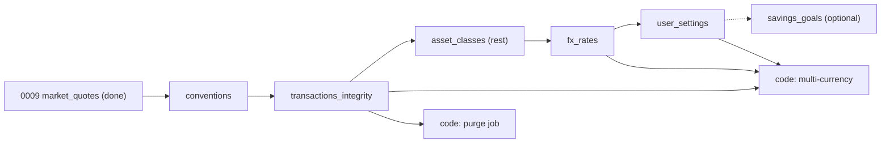

# Coffer data model

The database's current state, its known issues, modeling rules for the team, and the planned direction. The current ER diagram is in [architecture.md §6](architecture.md#6-data-model). When code and this document disagree, the migrations in `src/backend/alembic/versions/` are the source of truth; this document describes the **direction**.

Database: PostgreSQL 16 in Docker (`compose.yaml`). Only Alembic migrations create the schema; tests build it with `alembic upgrade head` too, so CHECK constraints apply in tests.

## 1. Current state

### 1.1 Migrations

| Revision | Scope |
|---|---|
| `0001_initial` | `users`, `auth_sessions`, `categories` (11 seeded rows), `transactions` |
| `0002_import_drafts` | `import_drafts` |
| `0003_profile_agent` | `investment_profiles` (+ `agent_runs`, `suggestions`, dropped in `0010`) |
| `0004_portfolio` | `holdings` |
| `0005_accounts` | case-insensitive e-mail (`ux_users_email_lower`), `users.password_changed_at` / `last_login_at`, index on `auth_sessions.expires_at` |
| `0006_opening_balance` | `opening_balances` (module `cash`) |
| `0007_agent_actions` | (all dropped in `0010`) `agent_runs` / `suggestions` for agent actions (`provider`, `params`, `steps`, `llm_calls`, `cost_usd`, `report`, `source`, `ai_status`, CHECKs, `(user_id, created_at)` indexes), `llm_usage_daily` |
| `0008_budget_limits` | `budget_limits` (dropped in `0012`) |
| `0009_market_quotes` | `market_quotes` |
| `0010_drop_agent` | drops `agent_runs`, `suggestions`, `llm_usage_daily` (AI assistant removed; `downgrade` recreates them empty) |
| `0011_drop_tx_currency` | drops `transactions.currency` and `transactions.base_amount` (PLN only; `amount` is the value; `downgrade` re-adds both, filled from `amount`) |
| `0012_ui_upgrades` | adds `users.display_name` (`varchar(50)`, NOT NULL; the upgrade first deletes all users, so all data); renames profile classes `stocks→stock`, `bonds→bond`, `deposit→cash`; drops `budget_limits` (`downgrade` recreates it empty and maps classes back; `commodity` and the `deposit`/`cash` merge are not restored) |

New revisions take the next free number from `0013`; `down_revision` is always the current head (`alembic heads`).

### 1.2 Table notes

What the ER diagram doesn't show:
- **`users` / `auth_sessions`** (`accounts`): `display_name` is required (1–50 characters, set at registration). E-mail is stored normalized and is unique on `lower(email)`. The `0005` downgrade cannot restore the original letter case. Expired sessions are removed only on logout. Login rate limiting (`accounts/ratelimit.py`) is in process memory, so it resets on restart and isn't shared between workers; scaling out would need a table.
- **`categories`** (`transactions`): global and seeded. There is no stable category code (logic uses the Polish name), and nothing guarantees exactly one default.
- **`transactions`**: PLN only: `amount` is the value (no `currency` or `base_amount` columns since `0011`). `amount` and `source` have no CHECK constraints.
- **`import_drafts`** (`imports`): an expired draft is removed only when the **same** user accesses imports again.
- **`investment_profiles`** (`profile`): `preferred_classes` is JSONB and uses the shared asset-class list (`AssetClass` in `coffer/analytics/allocation.py`: `stock, etf, bond, real_estate, commodity, crypto, cash`).
- **`market_quotes`**: global, one row per symbol per day (UPSERT). FX rates are stored here as `<CCY>PLN=X` pairs; there is no `fx_rates` table.
- **`opening_balances`** (`cash`): the amount may be negative; the balance is valid at the end of `as_of`, and later transactions add to it.

### 1.3 Known issues (most serious first)

1. **Multi-currency exists only on paper.** `transactions` has no `currency` / `base_amount` (dropped in `0011`); the service writes PLN and the parser rejects other currencies. There is no stored FX rate per transaction and no per-user base currency (assumption A4).
2. **`holdings.purchase_price` is `numeric(14,2)`**, which truncates unit prices below 0.01 (crypto, fund units).
3. **Missing CHECKs** on currencies, `transactions.amount` (allows 0), `source`, `investment_profiles.*`, `holdings.manual_value`. Validation lives only in Pydantic, so scripts can bypass it.
4. **Indexes:** `ix_transactions_user_id` duplicates `(user_id, date)`; there is no index on `transactions.category_id`.
5. **No retention:** expired sessions and abandoned import drafts grow forever. This is the main size risk for a small hosted database.
6. **Constraint names are generated by Postgres** (no `naming_convention` on `Base`).
7. **Minor:** `import_drafts.id` is `varchar(36)` instead of `uuid`; `transactions` and `holdings` lack `updated_at`; the `holdings` CHECKs exist only in the migration, not in `models.py`.

What stays: every FK to `users` cascades (account deletion is one `DELETE`), all timestamps are `timestamptz`, money is `numeric`, and JSONB is used only for documents.

## 2. Decisions

**(a) The portfolio is positions, not an operations log.** `holdings` stays the source of truth (class, ticker, quantity, average purchase price, date). An operations log would force a cost method (FIFO/average), realized gains, dividends and splits, which no requirement asks for. If history is ever needed, add `portfolio_operations` and turn each holding into an "opening" operation.

**(b) Quotes and FX in the database.** Done for quotes (`market_quotes`, price job). Still planned: `fx_rates (base_ccy, quote_ccy, rate_date)` from NBP, so a transaction is converted at the rate of its own date (A4) and the used rate is stored in `transactions.fx_rate` (reproducible N04). Memory cache (5 min) stays the first layer.

**(c) Global categories with a stable code.** Planned: `categories.code varchar(30) UNIQUE` (e.g. `food`, `own_transfer`) and `sort_order`, a partial unique index guaranteeing one default, FK `ON DELETE RESTRICT`. `code` separates logic (categorizer, analytics, agent) from the Polish UI name. No per-user categories.

**(d) Category limits were removed** (`0012` dropped `budget_limits`). Savings goals (F16, priority C) would be a separate `savings_goals` table.

**(e, g) Original currency plus a frozen base amount; base currency in `user_settings`.** Planned: `transactions` stores `amount` + `currency`, `fx_rate` and `base_amount = quantize(amount × fx_rate)`; totals use only `base_amount`; a missing rate rejects the row with a Polish error. Base currency goes in a new 1:1 `user_settings` table owned by `profile` (no row = PLN), and changing it is blocked once the user has transactions or holdings. Supported currencies are a constant in `coffer/core/money.py`, with `char(3)` + `CHECK (x ~ '^[A-Z]{3}$')`.

**(h) Hard delete and retention.** No soft delete anywhere: N09 requires permanent deletion. Every new user table **must** cascade from `users`. Planned retention (nothing implemented yet): delete expired `auth_sessions` and `import_drafts`; keep quotes for 3 years. Mechanism: each owning module exposes `purge_expired(db, now) -> int` in `service.py`; `coffer/scripts/purge.py` calls them (run by hand or on a schedule; no `pg_cron`). Size estimate: about 490 MB for 200 active accounts over 3 years; the demo needs under 20 MB.

**Other planned changes:** `holdings.purchase_price` → `numeric(20,8)`; `transactions` index `(user_id, date, id)` replacing the two current ones; `import_drafts.id` → `uuid`; CHECKs listed in §1.3. Integer ids stay (`bigint` is not needed at this volume).

### Table ownership

| Module | Tables | Read by (only through `service.py`) |
|---|---|---|
| `accounts` | `users`, `auth_sessions` | everyone via `deps.CurrentUser` |
| `profile` | `investment_profiles` (+ planned `user_settings`) | base currency for `transactions`/`portfolio`/`budget` |
| `transactions` | `categories`, `transactions` | `budget`, `imports` |
| `budget` | (none; optional `savings_goals`) | nobody |
| `imports` | `import_drafts` | nobody |
| `portfolio` | `holdings` | `budget` |
| `cash` | `opening_balances` | `budget` |
| `market` | `market_quotes` (+ planned `fx_rates`) | `portfolio`, `transactions` |
| `analytics` | none (pure functions on dataclasses) | |

Only the owning module changes its tables (migration + `models.py`). Cross-module FKs are allowed (e.g. `transactions.category_id → categories`), but a module never imports another module's models.

## 3. Modeling rules

1. **Naming.** Plural `snake_case` English table names; FK `<entity>_id`; dates `*_date` (`date`), moments `*_at` (`timestamptz`). Name constraints explicitly: `pk_<table>`, `fk_<table>_<col>_<ref>`, `uq_<table>_<cols>`, `ix_<table>_<cols>`, `ck_<table>_<name>`.
2. **Money.** Amounts `numeric(14,2)` + `Decimal`, rounded only with `coffer.core.money.quantize`. Unit prices and quantities `numeric(20,8)`, FX rates `numeric(18,8)`; price × quantity goes through `quantize` before it is stored as an amount. Strings in JSON. Never `float`, `real` or `money`.
3. **Currencies.** `char(3)` + a format CHECK; the supported list lives in code.
4. **Time.** Always UTC and `timestamptz`; `server_default=func.now()`; `updated_at` set by the ORM, no triggers.
5. **Value sets.** Small fixed lists → `varchar` + a named `CHECK … IN (…)`, with a tuple in `models.py` and a `Literal` in `schemas.py`. No Postgres `ENUM` (it doesn't downgrade cleanly). A lookup table only when values have attributes (`categories`).
6. **User data.** `user_id integer NOT NULL REFERENCES users ON DELETE CASCADE`, first in the table's main index; every query in `service.py` filters by it.
7. **Indexes** only for real queries in `service.py` (note which in the migration). A composite index replaces its prefix. Index FKs to user tables.
8. **CHECK and NOT NULL** for context-free rules (sign, format, value set); rules spanning rows or tables stay in `service.py`. Declare CHECKs in `__table_args__` too, because Alembic doesn't compare them.
9. **JSONB** only for documents read as a whole (snapshot, draft), never for anything filtered or summed; each JSONB column gets a `jsonb_typeof` CHECK.
10. **No soft delete.**

### Migrations
- One revision per change; continuous numbering `NNNN_<description>.py`. Two changes with migrations must not run in parallel (there must be a single head).
- **Reversible:** every `upgrade` has a working `downgrade` (check with `alembic downgrade base` → `alembic upgrade head`). Lossy data migrations restore a best-effort state and say so in the docstring.
- **No long locks:** new NOT NULL columns only with `server_default`; CHECKs on user tables as `NOT VALID` then `VALIDATE CONSTRAINT`; table-rewriting type changes only on small tables; indexes on `transactions` with `CREATE INDEX CONCURRENTLY` inside `autocommit_block()`.
- **Data migrations are separate revisions** and use `sa.table()` / SQL, never `coffer.*` models. Exception: small tables (< 10k rows) where the backfill is a precondition of a constraint in the same revision, or seeding fixed lookup data.

### Testing
- Before merging a migration, run locally in `src/backend`: `uv run alembic heads` (exactly one), `upgrade head` on an empty DB, `alembic check` (no model/migration drift), `downgrade base` + `upgrade head`.
- Planned schema test: every table with `user_id` has a cascading FK to `users`, and deleting a user with data in every table leaves zero rows.
- Every CHECK gets a negative test (`IntegrityError`) in the owning module's tests.
- Locally: `COFFER_TEST_DB=coffer_test_<module>`.

## 4. Remaining plan

The migration chain is linear, so changes with migrations run **sequentially**; code-only changes can run in parallel. Each item should become an OpenSpec change (`openspec/changes/`).

| Item | Scope | Risk |
|---|---|---|
| `conventions` | `naming_convention` in `core/db.py`, rename existing constraints, cascade schema test | low (metadata only; watch `alembic check` drift) |
| `transactions_integrity` | category `code`/`sort_order`/single default; `transactions.fx_rate`, `updated_at`, `char(3)` currency, CHECKs, RESTRICT FK, `(user_id, date, id)` index, `category_id` index; `import_drafts.id` → `uuid`, `rows` CHECK | medium (type changes rewrite tables; `amount <> 0` via `NOT VALID`) |
| `asset_classes` | `purchase_price numeric(20,8)`, holdings CHECKs and `updated_at` (the shared vocabulary is done, `0012`) | medium |
| `fx_rates` | historical FX table and `get_fx_rate_on(db, ccy, day)` (weekend → last business day) | low |
| `user_settings` | base currency, `GET/PUT /api/settings`, change blocked once data exists | low |
| multi-currency (code) | `base_amount` from `fx_rates` by date; foreign currencies in import | medium (N04 correctness) |
| purge (code) | `purge_expired` per module, `scripts/purge.py`, a `make purge` target | low |
| `savings_goals` (optional, F16) | table + F17 in `analytics` | low |
