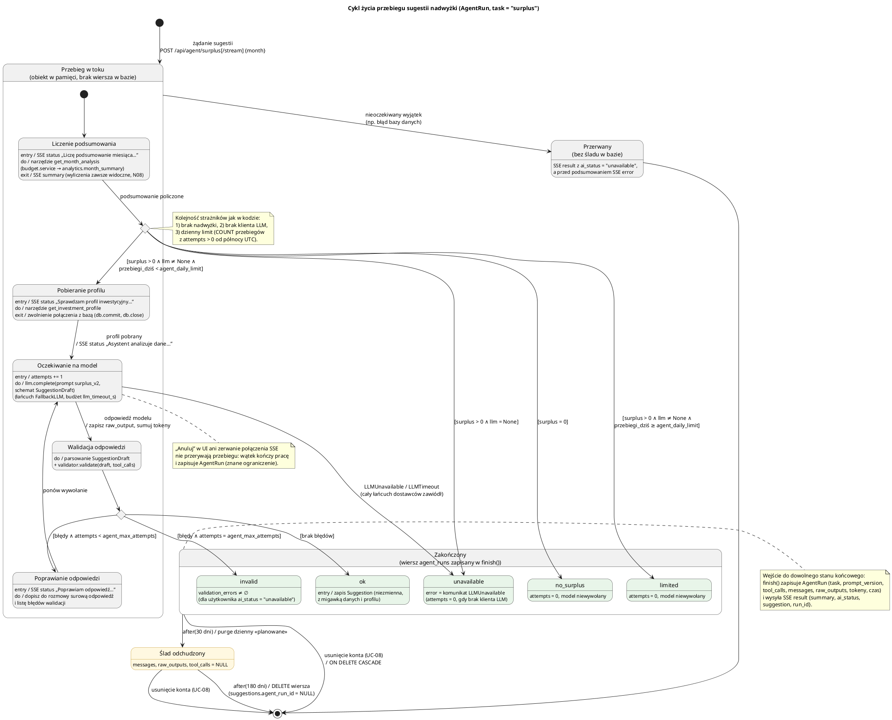

# Diagram stanów: przebieg sugestii nadwyżki (`AgentRun`)

Dokument modeluje cykl życia jednego obiektu domenowego Coffer w notacji diagramu stanów UML (PlantUML) i uzasadnia trzy decyzje projektowe, które ten cykl kształtują.

Pojęcia mają znaczenie ze [słownika](glossary.md). Wymagania (F/N) pochodzą z [requirements.md](requirements.md), a przypadek użycia z [UC-12](use-cases/UC-12-surplus-suggestion.md).

## 1. Wybrany obiekt i dlaczego

**Obiekt:** przebieg agenta AI, który na żądanie użytkownika tworzy **sugestię** wykorzystania **nadwyżki** z wybranego miesiąca (F31, UC-12). W kodzie odpowiada mu:

- workflow `run_surplus`: `src/backend/coffer/agent/workflows/surplus.py`,
- wiersz tabeli `agent_runs` (model `AgentRun`): `src/backend/coffer/agent/models.py`. Kolumna `status` przyjmuje wartości `ok | no_surplus | unavailable | invalid | limited`,
- przy sukcesie dodatkowo wiersz `suggestions` (model `Suggestion`).

Uzasadnienie wyboru: stan tego obiektu realnie zmienia się w czasie i zależy od zdarzeń zewnętrznych, takich jak odpowiedź modelu, błąd dostawcy, wynik walidatora czy upływ doby i dni retencji. To najbogatszy cykl życia w systemie. Ma pięć stanów końcowych, pętlę poprawki odpowiedzi, limit dzienny, ścieżki zastępcze (N08) i retencję śladu. Prostsze obiekty są w praktyce tylko CRUD-em: transakcja, pozycja portfela i profil są tworzone, zmieniane i usuwane bez stanów pośrednich. Szkic importu (`ImportDraft`) ma tylko trzy stany: podgląd, zatwierdzony i wygasły.

Diagram opisuje **stan obecny kodu** (migracje `0001`–`0005`). Retencja oznaczona jako «planowane» pochodzi z [data-model.md, decyzja (h)](data-model.md) i nie jest jeszcze zaimplementowana.

## 2. Diagram stanów

### Słownik stanów i zdarzeń

| Element | Znaczenie | Źródło w kodzie |
|---|---|---|
| Przebieg w toku | Workflow działa w wątku żądania (`POST /surplus`) albo w wątku roboczym (`/surplus/stream`). Stan istnieje tylko w pamięci. | `agent/api.py`, `agent/sse.py` |
| `precheck` | Rozgałęzienie bez kosztu LLM: nadwyżka, konfiguracja dostawcy, limit dzienny. | `run_surplus`, `service.count_runs_today` |
| Oczekiwanie na model ↔ Poprawianie | Pętla `while attempts < agent_max_attempts` (domyślnie 2, czyli 1 wywołanie + 1 poprawka). | `run_surplus`, `core/config.py` |
| Walidacja | Odrzuca pusty tekst, odwołanie do niedostępnego profilu lub portfela i liczby, których nie ma w wynikach narzędzi (F32, N04). | `agent/validator.py` |
| Zakończony | Pięć wartości `agent_runs.status`. Wejście do każdej oznacza `finish()`: zapis `AgentRun` i zdarzenie SSE `result`. | `run_surplus.finish` |
| Przerwany | Wyjątek spoza przewidzianych ścieżek. Nie powstaje wiersz w bazie, a użytkownik dostaje odpowiedź zastępczą. | `surplus_stream.work` |
| Ślad odchudzony «planowane» | Retencja treści śladu 30 dni i wiersza 180 dni. | `docs/data-model.md` 2.9 |

### Jak stan widzi użytkownik

| `agent_runs.status` | `ai_status` w API | Stan panelu asystenta (`assistantReducer`) |
|---|---|---|
| `ok` | `ok` | `ok`: sugestia, uzasadnienie, ryzyka, zastrzeżenie (F33) |
| `no_surplus` | `no_surplus` | `no_surplus` |
| `limited` | `limited` | `limited`: „Osiągnięto dzienny limit…” |
| `unavailable`, `invalid` | `unavailable` | `unavailable`: „Asystent AI jest chwilowo niedostępny. Wyliczenia powyżej są aktualne.” |
| (Przerwany) | `unavailable` albo zdarzenie `error` | `unavailable` |

## 3. Decyzje projektowe

### Decyzja 1: stała sekwencja stanów z jedną poprawką zamiast swobodnej pętli agenta

**Problem.** Sugestia ma opierać się na danych użytkownika (F32), nie może podawać zmyślonych liczb (N04) i nie może psuć rdzenia, gdy model zawodzi (N08). Trzeba zdecydować, kto steruje przebiegiem: kod czy model.

**Rozważane alternatywy:**
1. Pętla tool use: model sam decyduje, które narzędzia wywołać i kiedy skończyć. Tak działa doradca portfela (`agent/investment/advisor.py`, do 4 kroków).
2. Jedno wywołanie modelu bez walidacji: odpowiedź pokazujemy taką, jaka przyszła.
3. Stała sekwencja sterowana kodem: kod sam woła narzędzia, potem następuje jedno wywołanie modelu, walidacja i najwyżej jedna poprawka.

**Wybrane rozwiązanie: 3.** Stany „Liczenie podsumowania” i „Pobieranie profilu” są deterministyczne. Model dostaje gotowe wyniki narzędzi i tylko je interpretuje. Pętla „Oczekiwanie na model ↔ Poprawianie” ma twardą granicę `agent_max_attempts = 2`. Uzasadnienie:
- zasada z `plan.md` „rdzeń liczy, agent interpretuje” i tabela 4.3, która przypisuje F31 tryb „Workflow, 1 wywołanie LLM”,
- liczba wywołań, a więc koszt i czas, jest z góry ograniczona,
- każdą ścieżkę da się przetestować `FakeLLM` ze skryptowanymi odpowiedziami,
- jedna poprawka z listą błędów walidatora naprawia typowe pomyłki modelu (np. odwołanie do brakującego profilu), a kolejne zwykle nic nie zmieniają.

**Konsekwencje:**
- (+) Diagram ma skończoną, małą liczbę ścieżek, a każda kończy się jednym z pięciu statusów.
- (+) Test „dwie złe odpowiedzi → `invalid`” jest prosty i deterministyczny.
- (−) Model nie może sam dociągnąć dodatkowych danych (np. portfela). Rozszerzenie wymaga zmiany kodu workflow, nie tylko promptu.
- (−) Poprawka podwaja czas odpowiedzi w najgorszym przypadku. Dlatego istnieje stan „Poprawianie” z osobnym komunikatem SSE.
- (−) Walidator jest celowo łagodny (całkowite < 100 nie są sprawdzane), więc `ok` nie gwarantuje braku każdej zmyślonej liczby.

### Decyzja 2: brak nadwyżki, brak modelu i limit to stany końcowe sprawdzane przed wywołaniem modelu, a nie błędy HTTP

**Problem.** Trzy sytuacje wykluczają sensowne wywołanie modelu: nadwyżka 0 (UC-12, 3a), wyłączony dostawca (`COFFER_LLM_PROVIDER=none`) i wyczerpany dzienny limit. Trzeba zdecydować, jak je zgłaszać i czy liczyć do limitu.

**Rozważane alternatywy:**
1. Kody błędów HTTP: 422 dla braku nadwyżki, 503 dla braku modelu, 429 dla limitu.
2. Wywołać model mimo wszystko i pozwolić mu odpowiedzieć „brak nadwyżki”.
3. Zawsze odpowiadać 200 z polem `ai_status` i podsumowaniem miesiąca, a te przypadki rozstrzygać w `precheck` przed wywołaniem modelu.

**Wybrane rozwiązanie: 3.** Strażnicy `precheck` działają w ustalonej kolejności. Odpowiedź zawsze zawiera policzone podsumowanie. Do limitu liczą się tylko przebiegi, które naprawdę wywołały model (`attempts > 0`). Uzasadnienie:
- N08: wyliczenia są pokazywane zawsze, a endpoint „nigdy nie zwraca 5xx z powodu LLM” (karta E1-05),
- brak nadwyżki nie kosztuje wywołania modelu i daje jednoznaczną odpowiedź,
- frontend ma jeden kształt odpowiedzi i mapuje `ai_status` 1:1 na stany reduktora,
- przebiegi bez wywołania modelu nie zjadają limitu użytkownika.

**Konsekwencje:**
- (+) Panel asystenta ma prostą, testowalną maszynę stanów (`assistantReducer`), lustrzaną wobec stanów końcowych.
- (+) Te przebiegi też zostawiają ślad w `agent_runs`, więc historia jest kompletna.
- (−) Limit działa jako „COUNT, a potem wywołanie”, więc dwa równoległe żądania mogą oba przejść strażnika. To wyścig odnotowany w `docs/tasks/README.md` i w `advisor.py`. Planowana naprawa to atomowe `reserve_run` na tabeli `llm_usage_daily` (migracja `0007`, `data-model.md` 2.8).
- (−) Klient HTTP nie może rozpoznać limitu po samym kodzie statusu. Musi czytać `ai_status`.

### Decyzja 3: każdy stan końcowy trwale zapisuje ślad, a sugestia żyje niezależnie od śladu

**Problem.** Trzeba ustalić, które przebiegi zapisywać, ile szczegółów rozróżniać i jak powiązać przebieg z sugestią, którą użytkownik widzi w historii. Do tego dochodzą ograniczenia rozmiaru bazy (Neon Free 0,5 GB) i prywatności (N03, N09).

**Rozważane alternatywy:**
1. Zapisywać tylko udane sugestie, bez śladu przebiegu.
2. Zapisywać ślad, ale jednym statusem „błąd” dla wszystkich porażek.
3. Trzymać treść sugestii w tym samym wierszu co ślad.
4. Wejście do każdego stanu końcowego zapisuje `AgentRun` z rozróżnionym statusem. `Suggestion` powstaje tylko w `ok`, jest niezmienna i odpięta od śladu (`ON DELETE SET NULL`).

**Wybrane rozwiązanie: 4.** Uzasadnienie:
- ślad (`messages`, `tool_calls`, `raw_outputs`, `validation_errors`) pokazuje, co dokładnie zobaczył model. Daje to dowód zgodności z N03 i widok dydaktyczny `/assistant/runs/:id`,
- odróżnienie `invalid` od `unavailable` w bazie pozwala oddzielić awarię dostawcy od słabej jakości odpowiedzi, mimo że użytkownik widzi w obu przypadkach ten sam komunikat,
- sugestia ma migawkę danych i profilu, więc późniejsza zmiana profilu jej nie zmienia (UC-05),
- odpięcie sugestii od śladu pozwala usuwać ciężki ślad (retencja) bez utraty historii sugestii.

**Konsekwencje:**
- (+) Cykl życia ma czytelne zakończenie: każdy przebieg kończy się dokładnie jednym wierszem `agent_runs`. Wyjątek to stan „Przerwany”.
- (+) Usunięcie konta (UC-08, N09) czyści oba obiekty kaskadą `ON DELETE CASCADE`.
- (−) Ślad rośnie o kilka do kilkunastu KB na przebieg. Bez retencji (stan „Ślad odchudzony”, dziś tylko «planowane») to największe ryzyko rozmiaru bazy.
- (−) Ścieżka „Przerwany” nie zostawia śladu, więc rzadkie awarie infrastruktury nie są widoczne w historii przebiegów, tylko w logach.
- (−) Przebieg anulowany przez użytkownika i tak kończy się zapisem. Ślad może więc pokazywać sugestię, której użytkownik nie zobaczył.

## 4. Źródła

- Kod: `src/backend/coffer/agent/workflows/surplus.py`, `agent/{api,service,models,schemas,validator,drafts,sse,llm}.py`, `agent/investment/advisor.py` (wspólny licznik limitu), `core/config.py`, `src/frontend/src/features/assistant/state.ts`.
- Dokumentacja: `docs/plan.md` (sekcje 1, 4.3–4.6), `docs/data-model.md` (1.2, 2.8, 2.9), `docs/use-cases/UC-12-surplus-suggestion.md`, `docs/tasks/E1-05`, `E2-04`, `E2-05`, `E3-03`, `docs/tasks/README.md` (odłożone ograniczenia).
