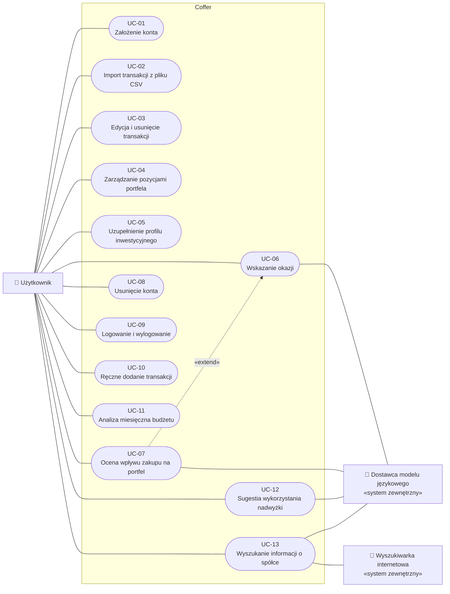

# Przypadki użycia

Przypadki użycia opisują, jak **użytkownik** korzysta z systemu Coffer, żeby zrealizować scenariusze z [wizji](../vision.md).
Każdy przypadek użycia odwołuje się do [wymagań](../requirements.md), a pojęcia mają znaczenie ustalone w [słowniku](../glossary.md).

Nowy przypadek użycia tworzymy na podstawie [szablonu](_template.md).

## Diagram przypadków użycia

## Katalog przypadków użycia

| ID                                        | Przypadek użycia                                  | Aktor                                  | Wymagania                         |
| ----------------------------------------- | ------------------------------------------------- | -------------------------------------- | --------------------------------- |
| [UC-01](UC-01-create-account.md)          | Założenie konta                                   | Użytkownik                             | F01, F02, N01, N06                |
| [UC-02](UC-02-import-transactions.md)     | Import transakcji z pliku CSV                     | Użytkownik                             | F04, F05, F07, F08, N04           |
| [UC-03](UC-03-edit-transaction.md)        | Edycja i usunięcie transakcji, zmiana kategorii   | Użytkownik                             | F05, F06, F08, N04                |
| [UC-04](UC-04-manage-portfolio.md)        | Zarządzanie pozycjami portfela                    | Użytkownik                             | F20, F21, F22, F23, F25           |
| [UC-05](UC-05-investment-profile.md)      | Uzupełnienie profilu inwestycyjnego               | Użytkownik                             | F30                               |
| [UC-06](UC-06-find-opportunities.md)      | Wskazanie okazji                                  | Użytkownik, Dostawca modelu językowego | F30, F32, F33, F36, N03, N07, N08 |
| [UC-07](UC-07-assess-purchase-impact.md)  | Ocena wpływu zakupu na portfel                    | Użytkownik, Dostawca modelu językowego | F23, F32, F33, F37, N03, N08      |
| [UC-08](UC-08-delete-account.md)          | Usunięcie konta                                   | Użytkownik                             | F09, N02, N09                     |
| [UC-09](UC-09-log-in.md)                  | Logowanie i wylogowanie                           | Użytkownik                             | F01, F02, N02                     |
| [UC-10](UC-10-add-transaction.md)         | Ręczne dodanie transakcji                         | Użytkownik                             | F03, N04, N06                     |
| [UC-11](UC-11-monthly-analysis.md)        | Analiza miesięczna budżetu                        | Użytkownik                             | F10–F15, N04, N08                 |
| [UC-12](UC-12-surplus-suggestion.md)      | Sugestia wykorzystania nadwyżki                   | Użytkownik, Dostawca modelu językowego | F31, F32, F33, N03, N08           |
| [UC-13](UC-13-company-info.md)            | Wyszukanie informacji o spółce                    | Użytkownik, Dostawca modelu językowego, Wyszukiwarka internetowa | F34, F35, N07, N08 |
